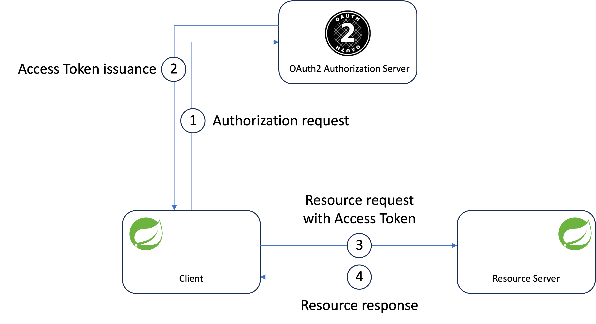
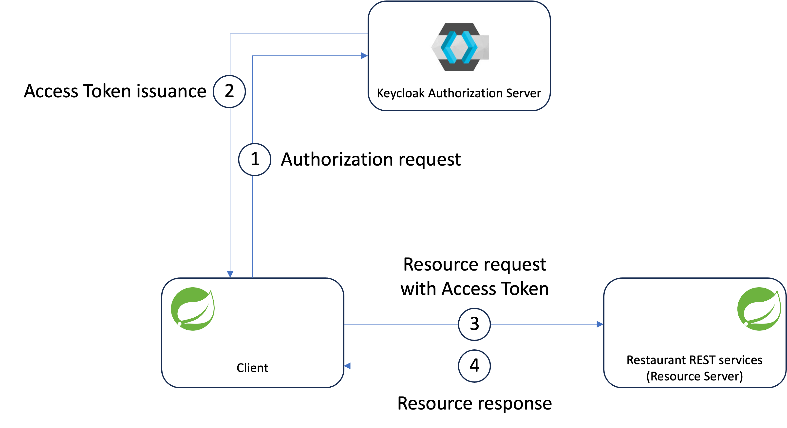
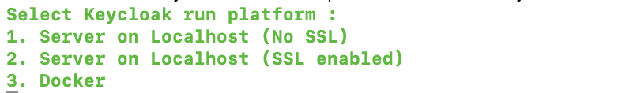
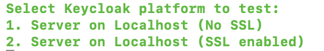

# Windfire Security
- [Introduction](#introduction)
- [Security protocols](#security-protocols)
    - [OAuth2](#OAuth2)
- [Identity and access management](#identity-and-access-management)
    - [Keycloak](#Keycloak)
        - [Run Keycloak as server on localhost](#run-keycloak-as-server-on-localhost)
        - [Install and run Keycloak as server on a Raspberry Pi box](#install-and-run-keycloak-as-server-on-a-raspberry-pi-box)
        - [Secure and run Keycloak server with TLS self signed certificate](#secure-and-run-keycloak-server-with-tls-self-signed-certificate)
        - [Run Keycloak on Docker](#run-keycloak-on-docker)
        - [Test Keycloak functioning](#test-keycloak-functioning)
- [Windfire Root CA and certificates](#windfire-root-ca-and-certificates)
- [Encrypting secrets with sops](#encrypting-secrets-with-sops)
- [Authentication Service](#authentication-service)
    - [First-time setup](#first-time-setup)
    - [Running the Authentication Service](#running-the-authentication-service)
    - [API endpoints](#api-endpoints)
- [Testing the Authentication Service](#testing-the-authentication-service)
- [Deployment](#deployment)

## Introduction
This repository provides the authentication/authorization infrastructure for the Windfire application suite. It has three main parts:

1. **[server/](server/)** — a Python FastAPI "Windfire Security Authentication Service" that fronts Keycloak. Other Windfire services never talk to Keycloak directly; they call this service's `/v1/security/auth` and `/v1/security/verify` endpoints instead.
2. **[keycloak/](keycloak/)** — shell scripts to run Keycloak itself (localhost, Docker, or Raspberry Pi) and to configure TLS on the Keycloak server.
3. **[ssl/](ssl/)** — shell scripts to generate the Windfire self-signed Root CA and per-host server certificates used across the whole Windfire suite (not just this service).

A companion sibling repo, `windfire-security-client`, provides the client module other services (and this repo's own `test/` scripts) use to call the Authentication Service.

## Security protocols
Security protocols are foundational elements of modern IT systems, serving as standardized frameworks for securing communication and data exchange over networks. 

These protocols define rules and procedures that govern authentication, encryption, and data integrity, ensuring confidentiality, integrity, and availability of information. 

By implementing security protocols such as TLS, SSH, and IPsec, organizations can establish secure connections, authenticate users and devices, and protect against unauthorized access and data breaches. 

Security protocols play a critical role in fortifying IT infrastructures, safeguarding sensitive data, and upholding the trust and integrity of digital interactions.

### OAuth2
OAuth2 is a security protocol playing a pivotal role in securing APIs and applications by providing a standardized way of handling authentication.

OAuth2 defines four roles (as described in https://datatracker.ietf.org/doc/html/rfc6749#section-1.1):
* **Resource Owner**: An entity capable of granting access to a protected resource. When the resource owner is a person, it is referred to as an end-user.
* **Resource server**: The server hosting the protected resources, capable of accepting and responding to protected resource requests using access tokens.
* **Client**: An application making protected resource requests on behalf of the resource owner and with its authorization. The term "client" does not imply any particular implementation characteristics (e.g., whether the application executes on a server, a desktop, or other devices).
* **Authorization server**: The server issuing access tokens to the client after successfully authenticating the resource owner and obtaining authorization.

Conceptually, an OAuth2 enabled architecture looks like the following picture.



## Identity and access management
Identity and Access Management (IAM) systems are fundamental components of modern cybersecurity strategies, providing organizations with the means to manage and control access to their digital resources. 

IAM systems enable businesses to securely authenticate users, grant appropriate permissions, and enforce policies across diverse IT environments. 

By centralizing user identities and access controls, IAM solutions streamline user provisioning, simplify compliance efforts, and mitigate security risks associated with unauthorized access. These systems play a crucial role in safeguarding sensitive data, protecting against insider threats, and ensuring regulatory compliance within organizations.

### Keycloak
Keycloak is an Open Source Identity and Access Management technology that allows to add authentication mechanisms to applications, securing them with minimum effort.

Keycloak provides user federation, strong authentication, user management, fine-grained authorization, and more.



As we all modern technologies, Keycloak can be deployed in different ways:

- A comprehensive guide on how to download, install and run Keycloak with OpenJDK is available here https://www.keycloak.org/getting-started/getting-started-zip
- A comprehensive guide on how to run Keycloak in Docker is available on Keycloak official website https://www.keycloak.org/getting-started/getting-started-docker.

All Keycloak scripts read their settings from **[common.sh](common.sh)**. `KEYCLOAK_VERSION` (*26.8.1*) is the single source of the local version, and `KEYCLOAK_HOME` (`~/software/keycloak-$KEYCLOAK_VERSION`) and the Docker image version derive from it. On raspberry01 the version is `keycloak_version` in **[conf/raspberry-config.yml](keycloak/deployment/raspberry/conf/raspberry-config.yml)**.

The procedures under **[keycloak/deployment/](keycloak/deployment/)** are:

| Script | What it does |
|---|---|
| [install-keycloak.sh](keycloak/deployment/install-keycloak.sh) `[1\|2] [--side-by-side]` | Fresh install on 1. Raspberry or 2. localhost |
| [upgrade-keycloak.sh](keycloak/deployment/upgrade-keycloak.sh) | Upgrades the Keycloak installed on raspberry01 |
| [backup-keycloak.sh](keycloak/deployment/backup-keycloak.sh) `[-v <version>] [-y]` | Backs up the Keycloak on raspberry01 to the Mac, encrypted with sops |
| [deploy-keycloak-tls.sh](keycloak/deployment/deploy-keycloak-tls.sh) | Deploys a new raspberry01 server certificate |
| [uninstall-keycloak.sh](keycloak/deployment/uninstall-keycloak.sh) `[-y]` | Removes Keycloak from raspberry01 |

#### Run Keycloak locally
**[start-keycloak.sh](keycloak/start-keycloak.sh)** `[1|2|3]` runs Keycloak in one of these modes, taken from the menu or from the argument:



1. **Server on localhost (no TLS)**: `kc.sh start-dev`, Admin console on http://localhost:8080/admin.
2. **Server on localhost (TLS enabled)**: `kc.sh start` with the localhost PEM certificate, Admin console on https://localhost:8443/admin (see [TLS](#secure-and-run-keycloak-server-with-tls-self-signed-certificate) below).
3. **Docker**: see [Run Keycloak on Docker](#run-keycloak-on-docker).

Options 1 and 2 check that `KEYCLOAK_HOME` holds a Keycloak installation (otherwise they point to `install-keycloak.sh 2`) and that Java 17 or later is available. On the first start, when `KEYCLOAK_HOME/data` does not exist yet, the script asks for the password of the temporary admin user (`admin`). It passes the password to Keycloak as `KC_BOOTSTRAP_ADMIN_USERNAME`/`KC_BOOTSTRAP_ADMIN_PASSWORD` environment variables, never on the command line. Log in with it, create a permanent admin user and delete the temporary one.

#### Install Keycloak from scratch
**[install-keycloak.sh](keycloak/deployment/install-keycloak.sh)** installs Keycloak on a fresh platform with Ansible. The platform comes from the menu or the first argument:

```bash
cd keycloak/deployment
./install-keycloak.sh 1    # Raspberry (raspberry01)
./install-keycloak.sh 2    # localhost
```

Both playbooks start with pre-flight checks. **If Keycloak is already installed, they print an alert, point to the upgrade procedure and stop without changing anything (exit code 0).**

**1. Raspberry** runs **[keycloak-install.yaml](keycloak/deployment/raspberry/keycloak-install.yaml)** against the `identitymanager` inventory group (raspberry01). sudo on the Pis requires the `pi` password, so it always asks for it (`BECOME password:`, via `-K` and `become_ask_pass=True` in **[ansible.cfg](keycloak/deployment/raspberry/ansible.cfg)**). The script first asks for the username (default `admin`) and password of a temporary admin user. The playbook then:

1. **Pre-flight**: Keycloak counts as installed if any of these exist: the `keycloak` systemd unit, `/etc/keycloak/keycloak.conf`, a `/opt/keycloak/keycloak-*` folder or the `keycloak` user. In that case it alerts and stops, pointing to `upgrade-keycloak.sh` (or `uninstall-keycloak.sh` to start over). Otherwise it checks that port 8443 is free on the Pi, and that the raspberry01 certificate, key and Windfire Keycloak Root CA exist on your machine. Issue them with `keycloak/security/setupTLS.sh 2 3` first.
2. **OS prerequisites** (**[raspberry.yaml](keycloak/deployment/raspberry/raspberry.yaml)**): apt update and upgrade, then `openjdk-21-jdk-headless` (`openjdk-17-jdk-headless` if the OS release has no 21).
3. **Install**: creates the `keycloak` system user and group. It downloads `keycloak-<version>.tar.gz`, checks it against the published `.sha1` and extracts it to `/opt/keycloak/keycloak-<version>`. It then writes `/etc/keycloak/keycloak.conf` (hostname `https://raspberry01:8443`, HTTPS only, PEM certificate, H2 `dev-file` database) and the `keycloak` systemd unit (`kc.sh start --optimized`, enabled at boot, no admin credentials). Finally it copies the certificate and key to `/etc/keycloak/tls`, runs `kc.sh build`, and creates the temporary admin with `kc.sh bootstrap-admin user`. The credentials reach the Pi as environment variables only.
4. **TLS and first start** (**[keycloak-tls-deploy.yaml](keycloak/deployment/raspberry/keycloak-tls-deploy.yaml)**): verifies the certificate chain and key, starts Keycloak and waits for `https://raspberry01:8443/realms/master/` with the Root CA.

Then log in to https://raspberry01:8443/admin with the temporary admin, create a permanent admin user and delete the temporary one. The install does not create the `windfire` realm or its clients: create or import them (each client needs an Audience mapper, see [Token verification](#token-verification)).

**2. localhost** runs **[localhost/keycloak-install.yaml](keycloak/deployment/localhost/keycloak-install.yaml)** without sudo. It installs `KEYCLOAK_VERSION` in `KEYCLOAK_HOME` (from [common.sh](common.sh)):

1. **Pre-flight**: if `KEYCLOAK_HOME` exists, it alerts and stops. If another `keycloak-*` version is installed next to it, it alerts and stops too; rerun with `--side-by-side` to install the new version beside it. There is no in-place upgrade on localhost: set `KEYCLOAK_VERSION` to the new version and install it side by side (the realms in the old `data/` are not copied). It also checks Java 17 or later and `unzip`.
2. **Install**: downloads `keycloak-<version>.zip`, checks it against the published `.sha1` and unzips it. If the localhost certificate from `setupTLS.sh 2 1` exists, it copies it to `KEYCLOAK_HOME/conf/tls` for `start-keycloak.sh 2`.

#### Uninstall Keycloak from raspberry01
**[uninstall-keycloak.sh](keycloak/deployment/uninstall-keycloak.sh)** asks you to type `raspberry01` to confirm (or pass `-y`). It runs **[keycloak-uninstall.yaml](keycloak/deployment/raspberry/keycloak-uninstall.yaml)**, which stops and disables the unit and removes the unit and its drop-ins, `/etc/keycloak` and the leftover `~/keycloak` scripts. It also removes the `keycloak` user and group, and `/opt/keycloak`: **every installed version, the realms database, and the upgrade backups and exports**.

#### Upgrade Keycloak on raspberry01
On raspberry01 Keycloak runs only as the `keycloak` systemd unit, configured by `/etc/keycloak/keycloak.conf`. The unit must not set `KEYCLOAK_ADMIN`/`KEYCLOAK_ADMIN_PASSWORD`, because the admin user already exists in the database.

**[upgrade-keycloak.sh](keycloak/deployment/upgrade-keycloak.sh)** asks for the target version (default: `keycloak_version` from `raspberry-config.yml`, *26.8.1*), checks its format and runs **[keycloak-upgrade.yaml](keycloak/deployment/raspberry/keycloak-upgrade.yaml)**:

```bash
cd keycloak/deployment
./upgrade-keycloak.sh
```

The playbook:

1. **Pre-flight**: reads the current `kc.sh` and version from the unit's `ExecStart` (if there is none, it points to `install-keycloak.sh 1`). It stops at once if that is already the target version.
   - It fails on a downgrade, or if `/opt/keycloak` has less free space than twice the current install plus 300 MB.
   - It fails if `keycloak.conf` uses options removed in Keycloak 26 (`hostname-url`, `hostname-admin-url`, `hostname-path`, `hostname-port`, `hostname-strict-backchannel`, `hostname-strict-https`, `proxy=`, `features=...hostname:v1`), or if Java is older than 17.
   - It records the `windfire` realm issuer, verified with the Windfire Keycloak Root CA. If the realm does not exist yet, it warns and skips the issuer check.
2. **Backup and export**: stops Keycloak and tars the current install (with `data/`) and `/etc/keycloak` into `/opt/keycloak/backup-<timestamp>.tgz` (mode 0600). It then runs `kc.sh export --users realm_file` into `/opt/keycloak/export-<timestamp>`.
3. **Install side by side**: downloads `keycloak-<version>.tar.gz` from the GitHub release, checks it against the published `.sha1` and extracts it to `/opt/keycloak/keycloak-<version>`. It **copies** `data/` there, plus any custom `providers/` and `themes/`, never `conf/`. The old install stays untouched as a rollback.
4. **Configure**:
   - Only when upgrading from a version older than 26.2 with the default H2 database (`db=dev-file` or no `db=`), it sets `db-username=sa`/`db-password=password` in `keycloak.conf`. Keycloak 26.2 changed the H2 default credentials, and those were the old defaults.
   - It removes any `KEYCLOAK_ADMIN*` variables from the unit.
   - It points `ExecStart` at the new `kc.sh` with the drop-in `/etc/systemd/system/keycloak.service.d/10-keycloak-version.conf`.
   - It runs `kc.sh build` if `ExecStart` uses `--optimized`.
5. **Start and verify**: waits up to 10 minutes for `https://raspberry01:8443/realms/master/` (the first start migrates the database) and checks that the `windfire` issuer is unchanged.

If anything fails after Keycloak is stopped, the playbook restores `keycloak.conf` and the previous drop-in, then restarts the old version on its own `data/`. Once the new version is validated, delete the old `/opt/keycloak/keycloak-<old version>` by hand.

#### Back up Keycloak from raspberry01
**[backup-keycloak.sh](keycloak/deployment/backup-keycloak.sh)** must run on the Mac (`mac_ip`, *192.168.1.27*, in **[keycloak-backup-config.yml](keycloak/deployment/raspberry/conf/keycloak-backup-config.yml)**). It asks for the Keycloak version (default: `keycloak_version` from `raspberry-config.yml`, *26.8.1*, or pass `-v`). It warns that Keycloak is stopped during the export, asks for confirmation (skip it with `-y`) and runs **[keycloak-backup.yaml](keycloak/deployment/raspberry/keycloak-backup.yaml)**:

```bash
cd keycloak/deployment
./backup-keycloak.sh
```

1. **Pre-flight**: fails, without stopping Keycloak, if the SSH connection does not come from `mac_ip`, if the unit does not run `/opt/keycloak/keycloak-<version>` (exporting with another version would migrate the database), or if `/opt/keycloak` lacks free space.
2. **Backup**: stops Keycloak, which locks its H2 database while it runs. Into a 0700 staging folder `/opt/keycloak/kc-backup-<timestamp>` it then:
   - runs `kc.sh export --users realm_file` into `export/`: every realm, `master` included, with its users, credentials, groups, roles, clients, client secrets, client scopes, identity providers and flows;
   - copies, under `files/` with their absolute paths, the install's `data/` (the raw H2 database), `conf/`, `providers/` and `themes/`, plus `/etc/keycloak` (`keycloak.conf`, TLS certificate and key) and the systemd unit with its drop-ins;
   - writes `MANIFEST.txt` with versions, realms, `ExecStart` and restore notes.

   Keycloak is started again and checked over HTTPS whatever happens (if it was running).
3. **Transfer**: archives the staging folder to `/opt/keycloak/kc-backup-<timestamp>.tgz` (mode 0600). It then fetches it to `~/opt/keycloak/backup/keycloak-<version>-backup-<timestamp>.tgz` (folder 0700, file 0600) and compares the sha256 checksums of both copies.
4. **Cleanup on the Pi**: only once the checksums match does it remove the archive from raspberry01 (`shred -u`). On any earlier failure nothing is removed, and the error lists the leftover paths (they hold secrets: remove them by hand once the backup is safe). The next run's pre-flight warns about any `kc-backup-*` leftover it finds.

Finally the script encrypts the archive with **[sops-crypt.sh](sops/sops-crypt.sh)** `-e -r -y` to `<archive>.sops.json`. The plain archive is deleted only after a verified round trip. Decrypt it with `sops/sops-crypt.sh -d -f <archive>.sops.json`.

**Restore** on a new installation: install Keycloak with `install-keycloak.sh 1`, stop it, and restore `files/etc/keycloak` and the unit files. Then either import the export as the `keycloak` user with `kc.sh --config-file=/etc/keycloak/keycloak.conf import --dir export/ --override true` (works on the same or a newer version), or, with the same version only, copy `files/opt/keycloak/keycloak-<version>/data` over the new `data/`. Start Keycloak again.

#### Secure and run Keycloak server with TLS self signed certificate
Keycloak can be configured to run with TLS enabled, loading the required certificate infrastructure using files in PEM format or from a Java Keystore. When both alternatives are configured, the PEM files takes precedence over the Java Keystores.

I referred to official Keycloak documentation instructions *https://www.keycloak.org/server/enabletls* to enable TLS on Keycloak server.

Keycloak's certificate is signed by a dedicated certificate authority, **Windfire Keycloak Root CA**, separate from the Windfire Root CA described in [Windfire Root CA and certificates](#windfire-root-ca-and-certificates).

The script **[setupTLS.sh](keycloak/security/setupTLS.sh)** uses OpenSSL 3 (`brew install openssl@3`) and offers these functions:

1. **Create Windfire Keycloak Root CA** (run once): creates an RSA 4096, AES-256 passphrase protected key and a self-signed certificate (`CN=Windfire Keycloak Root CA, O=Windfire`, `CA:TRUE, pathlen:0`, valid 10 years). It refuses to overwrite an existing Root CA.
   - certificate: `~/opt/keycloak/ssl/truststore/WindfireKeycloakRootCA.crt` (this is the file Keycloak clients must trust)
   - private key: `~/opt/keycloak/ssl/keystore/WindfireKeycloakRootCA.key` (mode 0600)
2. **Generate Keycloak server certificate**: asks for the environment and issues `windfire-keycloak.key` / `windfire-keycloak.crt` (RSA 3072, valid 397 days) signed by the Root CA, using SANs from **[openssl_config_localhost.ext](keycloak/security/openssl_config_localhost.ext)** or **[openssl_config_raspberry.ext](keycloak/security/openssl_config_raspberry.ext)**, then verifies the chain.
   - Development/Test: written to the *tls* subfolder (gitignored)
   - Production: written to `~/opt/keycloak/ssl/certs/raspberry`; the script prints how to install the files in `/etc/keycloak/tls` on raspberry01 and the two `https-certificate-*` lines for `keycloak.conf`
3. **Check**: read-only. It prints the Root CA and server certificate details and exits 1 if the server certificate does not chain to the Root CA or expires within 30 days (`RENEW_BEFORE_DAYS`). Renew yearly with function 2.
4. **Generate all**: 1 + 2.

The function and the environment (1=Development, 2=Test, 3=Production) can be passed as arguments, e.g. `./setupTLS.sh 3 3` checks the production certificate. Settings such as `CA_DAYS`, `SERVER_DAYS` and `RENEW_BEFORE_DAYS` can be overridden as environment variables.

```bash
cd keycloak/security
./setupTLS.sh 1      # once: create Windfire Keycloak Root CA (asks for the Root CA passphrase)
./setupTLS.sh 2 3    # issue the raspberry01 certificate (asks for the Root CA passphrase)
./setupTLS.sh 3 3    # check the raspberry01 certificate
```

**IMPORTANT: the Root CA private key must not stay on the filesystem.** After functions 1 and 2 the script prints, in red, the steps and exact commands to follow:

1. encrypt `WindfireKeycloakRootCA.key` with `sops`/`age` into `WindfireKeycloakRootCA.key.sops.json` and check that it decrypts back to the same key;
2. save the `.sops.json` in the Password Manager;
3. **delete both the private key and the `.sops.json` from the filesystem** (`rm -f ~/opt/keycloak/ssl/keystore/WindfireKeycloakRootCA.key*`).

The key is needed again only to sign or renew a server certificate (function 2): restore it from the Password Manager to `~/opt/keycloak/ssl/keystore/WindfireKeycloakRootCA.key`, run the script, then delete it again.

To enable TLS on a local Keycloak, first generate the localhost certificate with `./setupTLS.sh 2 1`, then run **[setupKeycloakMode.sh](keycloak/setupKeycloakMode.sh)**, which provides two options to enable and disable TLS respectively


If *option 1* is selected, the script does the following:

1. it copies `windfire-keycloak.crt` and `windfire-keycloak.key` from the *tls* subfolder to the **<KEYCLOAK_HOME>/conf/tls** folder (and removes any old `server.keystore` from **<KEYCLOAK_HOME>/conf**)
2. it runs **<KEYCLOAK_HOME>/bin/kc.sh build** command to rebuild Keycloak configuration and fully enable TLS

*Option 2* removes the certificate and key from **<KEYCLOAK_HOME>/conf/tls**.

Once everything has been properly setup, to run Keycloak with TLS enabled, we just need to select *option 2* when **[start-keycloak.sh](keycloak/start-keycloak.sh)** script is launched: it starts Keycloak with `--https-certificate-file` and `--https-certificate-key-file` pointing at those PEM files (no keystore password is needed any more).

Keycloak Admin console will respond on https://localhost:8443/admin. Browsers will complain unless `WindfireKeycloakRootCA.crt` is trusted on the machine; clients such as `curl` can use `--cacert ~/opt/keycloak/ssl/truststore/WindfireKeycloakRootCA.crt`.

#### Run Keycloak on Docker
In case Docker is selected, Keycloak will run with the following default parameters values:
* **Keycloak Docker Image** set to *quay.io/keycloak/keycloak*
* **Keycloak Docker Image version** set to `KEYCLOAK_VERSION` (*26.8.1*)
* **Keycloak Container name** set to *keycloak*
* **Keycloak Admin console username** set to *admin*
* **Host port** set to `KEYCLOAK_PORT` if exported in your shell (e.g. `export KEYCLOAK_PORT=8081`), otherwise *8080*

The script checks that Docker is installed and running. If a container named *keycloak* already exists, it offers to start it again instead of creating a new one. Otherwise it asks for the password of the temporary admin user and passes it to the container as `KC_BOOTSTRAP_ADMIN_USERNAME`/`KC_BOOTSTRAP_ADMIN_PASSWORD`. Only the variable names appear on the `docker run` command line; the values come from the environment.

Once the container is running, Keycloak Admin Console will be available at **http://localhost:$KEYCLOAK_PORT/admin**.

#### Test Keycloak functioning
A convenient script **[testKeycloak.sh](keycloak/test/testKeycloak.sh)** is provided to run a simple curl command to authenticate with Keycloak and get back the authentication token to verify everything is setup and works fine.

The script allows to select whether TLS on Keycloak server is enabled or not



## Windfire Root CA and certificates
The [ssl/](ssl/) folder contains the scripts used to generate the Windfire self-signed Root CA and the per-host server certificates used across the whole Windfire suite, independently of Keycloak's own TLS setup described above.

- **[createRootCA.sh](ssl/createRootCA.sh)** generates the Windfire self-signed Root CA (`WindfireRootCA.key`/`.crt`) — self-signed with `basicConstraints=CA:true` and `keyUsage=keyCertSign,cRLSign` so it's usable as an actual signing authority, not just a leaf cert — and copies it into `~/opt/windfire/ssl/{keystore,truststore}`.
- **[generateServerCert.sh](ssl/generateServerCert.sh)** issues per-host server certificates off that CA, using **[openssl_config_localhost.ext](ssl/openssl_config_localhost.ext)** or **[openssl_config_raspberry.ext](ssl/openssl_config_raspberry.ext)** as the SAN configuration depending on the target host.

**`createRootCA.sh` must be run once before `generateServerCert.sh`** — the latter signs against the CA copies left in `~/opt/windfire/ssl/{keystore,truststore}` and will fail with a clear error if they're not there yet, rather than silently emitting an empty certificate:

```bash
cd ssl
./createRootCA.sh        # one-time (or whenever the Root CA needs rotating); prompts for the CA private key passphrase
./generateServerCert.sh  # prompts for environment (dev/staging/prod) and server Common Name (CN)
                          # dev/staging -> writes server/ssl/windfire-security.key + .crt
                          # prod        -> writes to ~/opt/windfire/ssl/certs/raspberry
```

Re-run `generateServerCert.sh` any time a server cert expires or a new host is added; the Root CA itself only needs to be created once and reused.

These are the certificates that `SSL_KEYFILE`/`SSL_CERTFILE` in the Authentication Service configuration point at (see below), and that the test scripts verify against.

## Encrypting secrets with sops
The [sops/](sops/) folder contains **[sops-crypt.sh](sops/sops-crypt.sh)**, a utility to encrypt and decrypt files with [sops](https://github.com/getsops/sops) and [age](https://github.com/FiloSottile/age) (`brew install sops age`). It has two modes:

- **File mode** (default): any file (private keys, certificates, `.env` files, ...) is encrypted in sops binary mode and stored as JSON, e.g. `WindfireKeycloakRootCA.key` → `WindfireKeycloakRootCA.key.sops.json`. After encrypting, the script checks that the result decrypts back to the same bytes, then asks whether to delete the plain file (`-r` deletes it without asking). Decryption writes the original file back, readable by the owner only (mode 0600), and reminds you to delete it if it holds a secret.
- **In-place mode** (`-i`): structured files (YAML, JSON, `.env`, INI) are encrypted or decrypted in place. Keys stay readable and only values are encrypted. The file is encrypted to a temporary copy, which replaces the original only once it decrypts correctly. Decrypted files are set to mode 0600. sops re-serializes the file, so YAML indentation may change.

The age key file defaults to `~/.config/sops/age/keys.txt` (`DEFAULT_SOPS_AGE_KEY_FILE` in [common.sh](common.sh)). You can preset it with the `SOPS_AGE_KEY_FILE` environment variable, or pass it with `-k`. For encryption, `-k` also accepts age public keys (`age1...`, comma-separated); in that case the round-trip check is skipped. Encryption always uses the chosen key, never `.sops.yaml` creation rules.

Any option you leave out is asked interactively. Before it runs, the script prints a summary with the exact sops command and asks for confirmation (`-y` skips every prompt). Run `./sops-crypt.sh -h` for all options.

```bash
cd sops
./sops-crypt.sh                                                                      # interactive menu
./sops-crypt.sh -e -f ~/opt/keycloak/ssl/keystore/WindfireKeycloakRootCA.key          # -> WindfireKeycloakRootCA.key.sops.json
./sops-crypt.sh -d -f ~/Downloads/WindfireKeycloakRootCA.key.sops.json -o ~/opt/keycloak/ssl/keystore/WindfireKeycloakRootCA.key
./sops-crypt.sh -e -i -f secrets.yaml                                                 # encrypt values in place
./sops-crypt.sh -d -i -k ~/other/keys.txt -f secrets.yaml                             # decrypt in place with another key
```

The old `encrypt-sops.sh` positional form still works: `./sops-crypt.sh 1 <input file> [output file]` encrypts and `./sops-crypt.sh 2 <input file> [output file]` decrypts.

The script refuses to encrypt a file that is already sops-encrypted, or to decrypt one that is not. It never overwrites an existing output file without asking, and removes a partial or unverified output if something fails.

## Authentication Service
The [server/](server/) folder contains the Windfire Security Authentication Service: a FastAPI application that fronts Keycloak so that other Windfire services never need to talk to Keycloak directly.

### First-time setup
Copy the two placeholder configuration files (both gitignored — never commit real values):

```bash
cd server
cp .env_PLACEHOLDER .env
cp config/service_config.json_PLACEHOLDER config/service_config.json
```

- **`.env`** sets `APP_NAME`, `API_HOST`, `API_PORT`/`API_PORT_SECURE`, `SSL_KEYFILE`/`SSL_CERTFILE`, `ENFORCE_HTTPS`, `ALLOWED_HOSTS` and `KEYCLOAK_SERVER_URL`.
- **`config/service_config.json`** is a per-service Keycloak `realm`/`client_id`/`client_secret` map, keyed by service name (e.g. `windfire-calendar-srv`). This is how a single Authentication Service instance backs multiple Windfire client services.

### Running the Authentication Service
```bash
cd server
./start-auth-server.sh              # creates/activates venv, installs deps, runs on port 8000 (HTTP) or 8443 (HTTPS)
./start-auth-server.sh -p 9000      # custom port
./start-auth-server.sh -v           # verbose/DEBUG logging
./run-auth-server-background.sh     # same, but backgrounded, logs to logs/windfire-security-server.log
./stop-auth-server.sh               # stops the background server (on the Pi, use systemctl: see Deployment)
```

**[createPythonVenv.sh](server/createPythonVenv.sh)** / **[activatePythonVenv.sh](server/activatePythonVenv.sh)** / **[deactivatePythonVenv.sh](server/deactivatePythonVenv.sh)** manage a dedicated Python virtual environment; **[installPrereqs.sh](server/installPrereqs.sh)** pins the FastAPI/uvicorn/PyJWT/cryptography/python-dotenv versions installed into it.

### API endpoints
Routes are nested under a version prefix:
- `GET /v1/monitor/health` — service health check.
- `POST /v1/security/auth` — authenticates a user against Keycloak (via `authenticate_user`) and returns tokens.
- `POST /v1/security/verify` — verifies a token, by default locally against Keycloak's public keys (no special Keycloak client permissions needed). See [Token verification](#token-verification).

### Token verification
`/v1/security/verify` accepts a token only if all of these hold:
- the signature matches one of Keycloak's public keys (JWKS) for the service's realm;
- `aud` contains the service's `client_id` from `service_config.json`, so a token issued to another client of the same realm is rejected;
- `iss` equals `{KEYCLOAK_SERVER_URL}/realms/{realm}`;
- the token is not expired and has the `exp`, `iat`, `iss` and `aud` claims.

This needs two things on the Keycloak side:
- **An Audience mapper on every client** listed in `service_config.json`. By default, Keycloak access tokens carry `aud: account`, not the client ID. In the Keycloak admin console, open the client, go to *Client scopes* → *&lt;client&gt;-dedicated* → *Add mapper* → *By configuration* → *Audience*, and set *Included Client Audience* to the client itself with *Add to access token* on. Without it, every `/verify` call returns 401.
- **`KEYCLOAK_SERVER_URL` must match the issuer Keycloak writes into its tokens.** If Keycloak is configured with a different `hostname` (for example a public name rather than the URL the Authentication Service uses), the issuer check fails. Decode a token and compare its `iss` claim with `KEYCLOAK_SERVER_URL` when in doubt.

Keycloak's public keys are cached in memory for 10 minutes. A token signed with an unknown key ID (for example right after a key rotation) triggers a new fetch, but at most once every 30 seconds, so random key IDs cannot make the service call Keycloak on every request.

When verification fails, the response is always `401` with `{"detail": "Invalid or expired token"}`, including when the requested service is not configured. The actual reason (expired, wrong audience, wrong issuer, unknown service, and so on) is written only to the server log, in `logs/windfire-security-server.log`.

## Testing the Authentication Service
There's no automated test suite — the [test/](test/) folder contains manual/interactive scripts that exercise a running Authentication Service end-to-end:

```bash
cd test
./start-test-server.sh -e dev       # runs a dummy service with one endpoint protected by the Authentication Service
./run-test-client.sh -e dev         # hits health endpoints, authenticates via Keycloak, calls the protected endpoint
```

Both scripts prompt interactively for username/password/service, defaulting the service to `windfire-calendar-srv`. The `-e {dev|staging|prod}` flag selects which Authentication Service instance to target. **[installPrereqs.sh](test/installPrereqs.sh)** additionally installs the sibling `windfire-security-client` repo in editable mode.

## Deployment
The [deployment/](deployment/) folder contains scripts that run Ansible playbooks against the `security_service` host group of your Ansible inventory (`/etc/ansible/hosts`, i.e. `raspberry01`), using the SSH key `$HOME/.ssh/ansible_rsa`. The Authentication Service runs on the Pi as the `windfire-security` systemd service, on port `8444` (Keycloak already uses `8443` on that host). The scripts work from any folder.

```bash
deployment/deploy.sh [1]          # 1 = Raspberry
deployment/undeploy.sh [1] [-y]   # -y skips the confirmation prompt (not the sudo password)
deployment/deploy.sh --help
```

### What you need before deploying
* Ansible installed locally (`ansible-playbook` on `PATH`) and the SSH key `$HOME/.ssh/ansible_rsa`
* the sudo password of user `pi` on the Pi: sudo is not passwordless, so every playbook run asks for it as `BECOME password` ([ansible.cfg](deployment/raspberry/ansible.cfg) sets `become_ask_pass`)
* `rsync` both locally and on the Pi (used by the Ansible `synchronize` module)
* on the Pi: Python 3 and systemd with `systemd-creds` (systemd 250 or later, e.g. Raspberry Pi OS Bookworm)
* the Windfire Root CA in `$HOME/opt/windfire/ssl/truststore` (create it with [createRootCA.sh](ssl/createRootCA.sh))
* the Windfire Keycloak Root CA in `$HOME/opt/keycloak/ssl/truststore` (create it with [setupTLS.sh](keycloak/security/setupTLS.sh))
* `server/config/service_config.json` with the real Keycloak `realm`/`client_id`/`client_secret` of every client service (see [First-time setup](#first-time-setup))
* an Audience mapper on each of those Keycloak clients, and a `KEYCLOAK_SERVER_URL` that matches the issuer in Keycloak's tokens (see [Token verification](#token-verification)); otherwise `/v1/security/verify` rejects every token

The production certificate and key are generated for you if they are missing. Your local `server/.env` and `server/config/service_config.json` are not copied: the Pi gets its own `.env` built from the template, and the service configuration only as an encrypted credential.

### What `deploy.sh` does
1. **Pre-flight checks**: checks for `ansible-playbook`, the SSH key, both Root CAs and a valid `server/config/service_config.json`, and stops with a red error if one is missing. If `windfire-security.crt` / `.key` are missing from `$HOME/opt/windfire/ssl/certs/raspberry`, it runs [generateServerCert.sh](ssl/generateServerCert.sh): choose **3. Production** when asked.
2. **Configuration**: asks for the Keycloak server URL (the default is `KEYCLOAK_SERVER_URL` in your local `server/.env`).
3. **Playbook**: asks for the `pi` sudo password (`BECOME password`), then runs [windfire-security-deploy.yaml](deployment/raspberry/windfire-security-deploy.yaml), configured via **[conf/config.yaml](deployment/raspberry/conf/config.yaml)**:
   1. stops the `windfire-security` service, and any `authServer.py` process started by hand
   2. removes and recreates `/home/pi/windfire-security`, and copies the `server/` folder (without caches, the local venv, certificates, logs, `.env` and `service_config.json`)
   3. builds `server/.env` from [windfire-security.env.j2](deployment/raspberry/templates/windfire-security.env.j2) with non-secret values only (mode `0600`)
   4. copies the server certificate (`0644`) and key (`0600`) to `server/ssl`, the Windfire Root CA to `/home/pi/opt/windfire/ssl/truststore` and the Windfire Keycloak Root CA to `/home/pi/opt/keycloak/ssl/truststore` (`KEYCLOAK_CA_CERT_PATH`)
   5. copies [common.sh](common.sh), creates the virtual environment and runs `installPrereqs.sh`
4. **systemd**: encrypts your local `service_config.json` with `systemd-creds` into `/etc/credstore.encrypted/windfire-security-service-config` (the client secrets are never stored in plaintext on the Pi), installs the unit from [windfire-security.service.j2](deployment/raspberry/templates/windfire-security.service.j2), then enables and starts the service. The unit hands the decrypted file to the server through the `SERVICE_CONFIG_FILE` environment variable. systemd restarts the service 5 seconds after a failure and starts it at boot.
5. **Health check**: waits for port 8444 and calls `https://raspberry01:8444/v1/monitor/health`, checking the certificate against the Windfire Root CA. If the check fails, it prints the last 50 lines of the journal and of the service log, and the deploy fails.

Re-run `deploy.sh` whenever `service_config.json` changes (e.g. a new client service): the credential is rebuilt on every deploy.

### Managing the service on the Pi
```bash
sudo systemctl status windfire-security
sudo systemctl restart windfire-security
journalctl -u windfire-security -f
tail -f ~/windfire-security/server/logs/windfire-security.log          # service stdout/stderr
tail -f ~/windfire-security/server/logs/windfire-security-server.log   # application log (rotated daily)
```
`server/stop-auth-server.sh` refuses to kill a server managed by systemd (systemd would just restart it): use `systemctl stop` instead.

### What `undeploy.sh` does
After a confirmation prompt (skipped with `-y`) and the `pi` sudo password, [windfire-security-undeploy.yaml](deployment/raspberry/windfire-security-undeploy.yaml) stops and disables the service, removes the unit file and the encrypted credential, and deletes `/home/pi/windfire-security`. The Root CA truststores are left in place, since other Windfire services use them.
