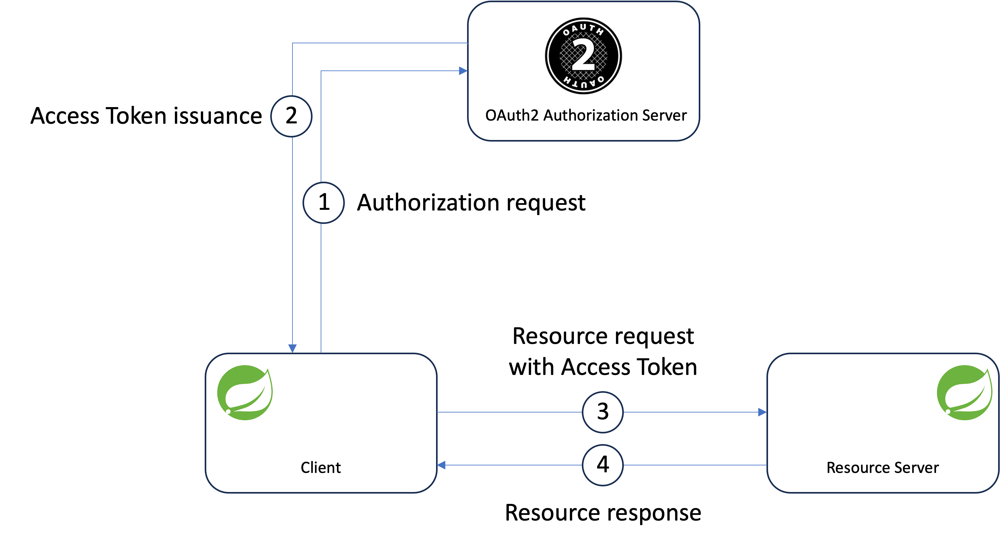
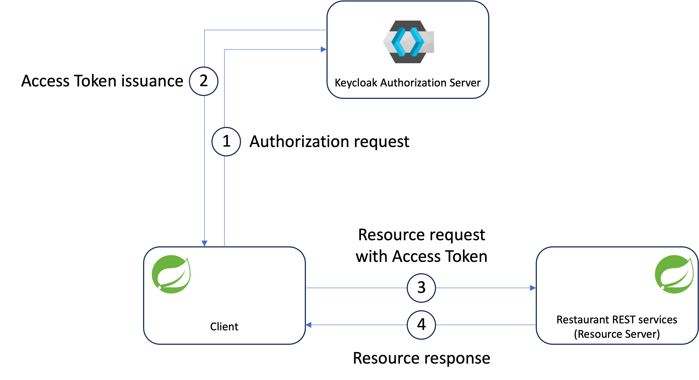
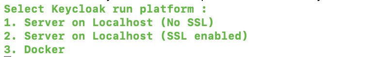
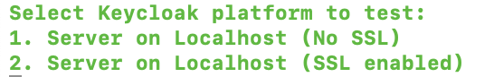

# Windfire Security
[](https://github.com/robipozzi/windfire-security/actions/workflows/ci.yml)

- [Introduction](#introduction)
- [Security protocols](#security-protocols)
    - [OAuth2](#OAuth2)
- [Identity and access management](#identity-and-access-management)
    - [Keycloak](#Keycloak)
        - [Run Keycloak as server on localhost](#run-keycloak-as-server-on-localhost)
        - [Install and run Keycloak as server on a Raspberry Pi box](#install-and-run-keycloak-as-server-on-a-raspberry-pi-box)
        - [Secure and run Keycloak server with TLS self signed certificate](#secure-and-run-keycloak-server-with-tls-self-signed-certificate)
        - [Run Keycloak on Docker](#run-keycloak-on-docker)
        - [Test Keycloak functioning](#test-keycloak-functioning)
- [Windfire Root CA and certificates](#windfire-root-ca-and-certificates)
    - [Root CA name constraints](#root-ca-name-constraints)
    - [Trusting the Root CAs on macOS](#trusting-the-root-cas-on-macos)
- [Encrypting secrets with sops](#encrypting-secrets-with-sops)
- [Authentication Service](#authentication-service)
    - [First-time setup](#first-time-setup)
    - [Running the Authentication Service](#running-the-authentication-service)
    - [API endpoints](#api-endpoints)
- [Testing the Authentication Service](#testing-the-authentication-service)
- [Deployment](#deployment)
- [Dependency monitoring and CI](#dependency-monitoring-and-ci)

## Introduction
This repository provides the authentication/authorization infrastructure for the Windfire application suite. It has three main parts:

1. **[server/](server/)** — a Python FastAPI "Windfire Security Authentication Service" that fronts Keycloak. Other Windfire services never talk to Keycloak directly; they call this service's `/v1/security/auth` and `/v1/security/verify` endpoints instead.
2. **[keycloak/](keycloak/)** — shell scripts to run Keycloak itself (localhost, Docker, or Raspberry Pi) and to configure TLS on the Keycloak server.
3. **[ssl/](ssl/)** — shell scripts to generate the Windfire self-signed Root CA and per-host server certificates used across the whole Windfire suite (not just this service).

A companion sibling repo, `windfire-security-client`, provides the client module other services (and this repo's own `test/` scripts) use to call the Authentication Service.

## Security protocols
Security protocols are foundational elements of modern IT systems, serving as standardized frameworks for securing communication and data exchange over networks. 

These protocols define rules and procedures that govern authentication, encryption, and data integrity, ensuring confidentiality, integrity, and availability of information. 

By implementing security protocols such as TLS, SSH, and IPsec, organizations can establish secure connections, authenticate users and devices, and protect against unauthorized access and data breaches. 

Security protocols play a critical role in fortifying IT infrastructures, safeguarding sensitive data, and upholding the trust and integrity of digital interactions.

### OAuth2
OAuth2 is a security protocol playing a pivotal role in securing APIs and applications by providing a standardized way of handling authentication.

OAuth2 defines four roles (as described in https://datatracker.ietf.org/doc/html/rfc6749#section-1.1):
* **Resource Owner**: An entity capable of granting access to a protected resource. When the resource owner is a person, it is referred to as an end-user.
* **Resource server**: The server hosting the protected resources, capable of accepting and responding to protected resource requests using access tokens.
* **Client**: An application making protected resource requests on behalf of the resource owner and with its authorization. The term "client" does not imply any particular implementation characteristics (e.g., whether the application executes on a server, a desktop, or other devices).
* **Authorization server**: The server issuing access tokens to the client after successfully authenticating the resource owner and obtaining authorization.

Conceptually, an OAuth2 enabled architecture looks like the following picture.



## Identity and access management
Identity and Access Management (IAM) systems are fundamental components of modern cybersecurity strategies, providing organizations with the means to manage and control access to their digital resources. 

IAM systems enable businesses to securely authenticate users, grant appropriate permissions, and enforce policies across diverse IT environments. 

By centralizing user identities and access controls, IAM solutions streamline user provisioning, simplify compliance efforts, and mitigate security risks associated with unauthorized access. These systems play a crucial role in safeguarding sensitive data, protecting against insider threats, and ensuring regulatory compliance within organizations.

### Keycloak
Keycloak is an Open Source Identity and Access Management technology that allows to add authentication mechanisms to applications, securing them with minimum effort.

Keycloak provides user federation, strong authentication, user management, fine-grained authorization, and more.



As we all modern technologies, Keycloak can be deployed in different ways:

- A comprehensive guide on how to download, install and run Keycloak with OpenJDK is available here https://www.keycloak.org/getting-started/getting-started-zip
- A comprehensive guide on how to run Keycloak in Docker is available on Keycloak official website https://www.keycloak.org/getting-started/getting-started-docker.

All Keycloak scripts read their settings from **[common.sh](common.sh)**. `KEYCLOAK_VERSION` (*26.8.1*) is the single source of the local version, and `KEYCLOAK_HOME` (`~/software/keycloak-$KEYCLOAK_VERSION`) and the Docker image version derive from it. On raspberry01 the version is `keycloak_version` in **[conf/raspberry-config.yml](keycloak/deployment/raspberry/conf/raspberry-config.yml)**.

The procedures under **[keycloak/deployment/](keycloak/deployment/)** are:

| Script | What it does |
|---|---|
| [install-keycloak.sh](keycloak/deployment/install-keycloak.sh) `[1\|2] [--side-by-side]` | Fresh install on 1. Raspberry or 2. localhost |
| [upgrade-keycloak.sh](keycloak/deployment/upgrade-keycloak.sh) | Upgrades the Keycloak installed on raspberry01 |
| [backup-keycloak.sh](keycloak/deployment/backup-keycloak.sh) `[-v <version>] [-y]` | Backs up the Keycloak on raspberry01 to the Mac, encrypted with sops |
| [schedule-keycloak-backup.sh](keycloak/deployment/schedule-keycloak-backup.sh) `[--remove] [-y]` | Installs (or removes) the weekly Keycloak backup on raspberry01, keeping the last 4 |
| [fetch-keycloak-backups.sh](keycloak/deployment/fetch-keycloak-backups.sh) `[-y]` | Copies the weekly backups to the Mac, encrypts them with sops and removes them from raspberry01 |
| [restore-keycloak.sh](keycloak/deployment/restore-keycloak.sh) `[-e localhost\|raspberry] [-f <backup>] [-m import\|data] [-p <port>] [-k] [-c] [-y]` | Restores a backup into a scratch Keycloak on the Mac (test) or into raspberry01, and checks realms, clients and users |
| [deploy-keycloak-tls.sh](keycloak/deployment/deploy-keycloak-tls.sh) `[ansible-playbook args, e.g. -e keycloak_force_build=true]` | Deploys a new raspberry01 server certificate and reinstalls the Keycloak systemd unit from its template |
| [uninstall-keycloak.sh](keycloak/deployment/uninstall-keycloak.sh) `[-y]` | Removes Keycloak from raspberry01 |

#### Run Keycloak locally
**[start-keycloak.sh](keycloak/start-keycloak.sh)** `[1|2|3]` runs Keycloak in one of these modes, taken from the menu or from the argument:



1. **Server on localhost (no TLS)**: `kc.sh start-dev`, Admin console on http://localhost:8080/admin.
2. **Server on localhost (TLS enabled)**: `kc.sh start` with the localhost PEM certificate, Admin console on https://localhost:8443/admin (see [TLS](#secure-and-run-keycloak-server-with-tls-self-signed-certificate) below).
3. **Docker**: see [Run Keycloak on Docker](#run-keycloak-on-docker).

Options 1 and 2 check that `KEYCLOAK_HOME` holds a Keycloak installation (otherwise they point to `install-keycloak.sh 2`) and that Java 17 or later is available. On the first start, when `KEYCLOAK_HOME/data` does not exist yet, the script asks for the password of the temporary admin user (`admin`). It passes the password to Keycloak as `KC_BOOTSTRAP_ADMIN_USERNAME`/`KC_BOOTSTRAP_ADMIN_PASSWORD` environment variables, never on the command line. Log in with it, create a permanent admin user and delete the temporary one.

#### Install Keycloak from scratch
**[install-keycloak.sh](keycloak/deployment/install-keycloak.sh)** installs Keycloak on a fresh platform with Ansible. The platform comes from the menu or the first argument:

```bash
cd keycloak/deployment
./install-keycloak.sh 1    # Raspberry (raspberry01)
./install-keycloak.sh 2    # localhost
```

Both playbooks start with pre-flight checks. **If Keycloak is already installed, they print an alert, point to the upgrade procedure and stop without changing anything (exit code 0).**

**1. Raspberry** runs **[keycloak-install.yaml](keycloak/deployment/raspberry/keycloak-install.yaml)** against the `identitymanager` inventory group (raspberry01). sudo on the Pis requires the `pi` password, so it always asks for it (`BECOME password:`, via `-K` and `become_ask_pass=True` in **[ansible.cfg](keycloak/deployment/raspberry/ansible.cfg)**). The script first asks for the username (default `admin`) and password of a temporary admin user. The playbook then:

1. **Pre-flight**: Keycloak counts as installed if any of these exist: the `keycloak` systemd unit, `/etc/keycloak/keycloak.conf`, a `/opt/keycloak/keycloak-*` folder or the `keycloak` user. In that case it alerts and stops, pointing to `upgrade-keycloak.sh` (or `uninstall-keycloak.sh` to start over). Otherwise it checks that port 8443 is free on the Pi, and that the raspberry01 certificate, key and Windfire Keycloak Root CA exist on your machine. Issue them with `keycloak/security/setupTLS.sh 2 3` first.
2. **OS prerequisites** (**[raspberry.yaml](keycloak/deployment/raspberry/raspberry.yaml)**): apt update and upgrade, then `openjdk-21-jdk-headless` (`openjdk-17-jdk-headless` if the OS release has no 21).
3. **Install**: creates the `keycloak` system user and group. It downloads `keycloak-<version>.tar.gz`, checks it against the published `.sha1` and extracts it to `/opt/keycloak/keycloak-<version>`. It then writes `/etc/keycloak/keycloak.conf` (hostname `https://raspberry01:8443`, HTTPS only, PEM certificate, H2 `dev-file` database) and the `keycloak` systemd unit (`kc.sh start --optimized`, enabled at boot, no admin credentials). Finally it copies the certificate and key to `/etc/keycloak/tls`, runs `kc.sh build`, and creates the temporary admin with `kc.sh bootstrap-admin user`. The credentials reach the Pi as environment variables only.
4. **TLS and first start** (**[keycloak-tls-deploy.yaml](keycloak/deployment/raspberry/keycloak-tls-deploy.yaml)**): verifies the certificate chain and key, starts Keycloak and waits for `https://raspberry01:8443/realms/master/` with the Root CA.

Then log in to https://raspberry01:8443/admin with the temporary admin, create a permanent admin user and delete the temporary one. The install does not create the `windfire` realm or its clients: create or import them (each client needs an Audience mapper, see [Token verification](#token-verification)).

**2. localhost** runs **[localhost/keycloak-install.yaml](keycloak/deployment/localhost/keycloak-install.yaml)** without sudo. It installs `KEYCLOAK_VERSION` in `KEYCLOAK_HOME` (from [common.sh](common.sh)):

1. **Pre-flight**: if `KEYCLOAK_HOME` exists, it alerts and stops. If another `keycloak-*` version is installed next to it, it alerts and stops too; rerun with `--side-by-side` to install the new version beside it. There is no in-place upgrade on localhost: set `KEYCLOAK_VERSION` to the new version and install it side by side (the realms in the old `data/` are not copied). It also checks Java 17 or later and `unzip`.
2. **Install**: downloads `keycloak-<version>.zip`, checks it against the published `.sha1` and unzips it. If the localhost certificate from `setupTLS.sh 2 1` exists, it copies it to `KEYCLOAK_HOME/conf/tls` for `start-keycloak.sh 2`.

#### Uninstall Keycloak from raspberry01
**[uninstall-keycloak.sh](keycloak/deployment/uninstall-keycloak.sh)** asks you to type `raspberry01` to confirm (or pass `-y`). It runs **[keycloak-uninstall.yaml](keycloak/deployment/raspberry/keycloak-uninstall.yaml)**, which stops and disables the unit and removes the unit and its drop-ins, `/etc/keycloak` and the leftover `~/keycloak` scripts. It also removes the `keycloak` user and group, and `/opt/keycloak`: **every installed version, the realms database, and the upgrade backups and exports**.

#### Upgrade Keycloak on raspberry01
On raspberry01 Keycloak runs only as the `keycloak` systemd unit, configured by `/etc/keycloak/keycloak.conf`. The unit must not set `KEYCLOAK_ADMIN`/`KEYCLOAK_ADMIN_PASSWORD`, because the admin user already exists in the database.

**[upgrade-keycloak.sh](keycloak/deployment/upgrade-keycloak.sh)** asks for the target version (default: `keycloak_version` from `raspberry-config.yml`, *26.8.1*), checks its format and runs **[keycloak-upgrade.yaml](keycloak/deployment/raspberry/keycloak-upgrade.yaml)**:

```bash
cd keycloak/deployment
./upgrade-keycloak.sh
```

The playbook:

1. **Pre-flight**: reads the current `kc.sh` and version from the unit's `ExecStart` (if there is none, it points to `install-keycloak.sh 1`). It stops at once if that is already the target version.
   - It fails on a downgrade, or if `/opt/keycloak` has less free space than twice the current install plus 300 MB.
   - It fails if `keycloak.conf` uses options removed in Keycloak 26 (`hostname-url`, `hostname-admin-url`, `hostname-path`, `hostname-port`, `hostname-strict-backchannel`, `hostname-strict-https`, `proxy=`, `features=...hostname:v1`), or if Java is older than 17.
   - It records the `windfire` realm issuer, verified with the Windfire Keycloak Root CA. If the realm does not exist yet, it warns and skips the issuer check.
2. **Backup and export**: stops Keycloak and tars the current install (with `data/`) and `/etc/keycloak` into `/opt/keycloak/backup-<timestamp>.tgz` (mode 0600). It then runs `kc.sh export --users realm_file` into `/opt/keycloak/export-<timestamp>`.
3. **Install side by side**: downloads `keycloak-<version>.tar.gz` from the GitHub release, checks it against the published `.sha1` and extracts it to `/opt/keycloak/keycloak-<version>`. It **copies** `data/` there, plus any custom `providers/` and `themes/`, never `conf/`. The old install stays untouched as a rollback.
4. **Configure**:
   - Only when upgrading from a version older than 26.2 with the default H2 database (`db=dev-file` or no `db=`), it sets `db-username=sa`/`db-password=password` in `keycloak.conf`. Keycloak 26.2 changed the H2 default credentials, and those were the old defaults.
   - It removes any `KEYCLOAK_ADMIN*` variables from the unit.
   - It points `ExecStart` at the new `kc.sh` with the drop-in `/etc/systemd/system/keycloak.service.d/10-keycloak-version.conf`.
   - It runs `kc.sh build` if `ExecStart` uses `--optimized`.
5. **Start and verify**: waits up to 10 minutes for `https://raspberry01:8443/realms/master/` (the first start migrates the database) and checks that the `windfire` issuer is unchanged.

If anything fails after Keycloak is stopped, the playbook restores `keycloak.conf` and the previous drop-in, then restarts the old version on its own `data/`. Once the new version is validated, delete the old `/opt/keycloak/keycloak-<old version>` by hand.

#### Back up Keycloak from raspberry01
**[backup-keycloak.sh](keycloak/deployment/backup-keycloak.sh)** must run on the Mac (`mac_ip`, *192.168.1.27*, in **[keycloak-backup-config.yml](keycloak/deployment/raspberry/conf/keycloak-backup-config.yml)**). It asks for the Keycloak version (default: `keycloak_version` from `raspberry-config.yml`, *26.8.1*, or pass `-v`). It warns that Keycloak is stopped during the export, asks for confirmation (skip it with `-y`) and runs **[keycloak-backup.yaml](keycloak/deployment/raspberry/keycloak-backup.yaml)**:

```bash
cd keycloak/deployment
./backup-keycloak.sh
```

1. **Pre-flight**: fails, without stopping Keycloak, if the SSH connection does not come from `mac_ip`, if the unit does not run `/opt/keycloak/keycloak-<version>` (exporting with another version would migrate the database), or if `/opt/keycloak` lacks free space.
2. **Backup**: stops Keycloak, which locks its H2 database while it runs. Into a 0700 staging folder `/opt/keycloak/kc-backup-<timestamp>` it then:
   - runs `kc.sh export --users realm_file` into `export/`: every realm, `master` included, with its users, credentials, groups, roles, clients, client secrets, client scopes, identity providers and flows;
   - copies, under `files/` with their absolute paths, the install's `data/` (the raw H2 database), `conf/`, `providers/` and `themes/`, plus `/etc/keycloak` (`keycloak.conf`, TLS certificate and key) and the systemd unit with its drop-ins;
   - writes `MANIFEST.txt` with versions, realms, `ExecStart` and restore notes.

   Keycloak is started again and checked over HTTPS whatever happens (if it was running).
3. **Transfer**: archives the staging folder to `/opt/keycloak/kc-backup-<timestamp>.tgz` (mode 0600). It then fetches it to `~/opt/keycloak/backup/keycloak-<version>-backup-<timestamp>.tgz` (folder 0700, file 0600) and compares the sha256 checksums of both copies.
4. **Cleanup on the Pi**: only once the checksums match does it remove the archive from raspberry01 (`shred -u`). On any earlier failure nothing is removed, and the error lists the leftover paths (they hold secrets: remove them by hand once the backup is safe). The next run's pre-flight warns about any `kc-backup-*` leftover it finds.

Finally the script encrypts the archive with **[sops-crypt.sh](sops/sops-crypt.sh)** `-e -r -y` to `<archive>.sops.json`. The plain archive is deleted only after a verified round trip. Decrypt it with `sops/sops-crypt.sh -d -f <archive>.sops.json`.

To test a backup or restore it, see [Restoring a Keycloak backup](#restoring-a-keycloak-backup).

#### Weekly scheduled backup on raspberry01
**[schedule-keycloak-backup.sh](keycloak/deployment/schedule-keycloak-backup.sh)** installs a systemd timer on raspberry01. Every week the timer backs up Keycloak on the Pi itself, with no Mac and no sudo password needed. It asks for confirmation (skip it with `-y`) and the pi sudo password, then runs **[keycloak-backup-schedule.yaml](keycloak/deployment/raspberry/keycloak-backup-schedule.yaml)**:

```bash
cd keycloak/deployment
./schedule-keycloak-backup.sh            # install or update
./schedule-keycloak-backup.sh --remove   # remove timer, service and script, keep the archives
```

The playbook installs `/usr/local/sbin/keycloak-backup`, `keycloak-backup.service` and `keycloak-backup.timer` from the [templates](keycloak/deployment/raspberry/templates). The settings are in **[keycloak-backup-config.yml](keycloak/deployment/raspberry/conf/keycloak-backup-config.yml)**:
- `scheduled_backup_on_calendar`: *Sun 03:30*, with `Persistent=true` (a run missed while the Pi was off runs at the next boot) and up to 10 minutes of random delay;
- `scheduled_backup_dir`: `/var/backups/keycloak`, owned by root with group `keycloak` and mode 0710;
- `scheduled_backup_keep`: *4*.

Each run has the same content as [backup-keycloak.sh](#back-up-keycloak-from-raspberry01) (export, `data/`, `conf/`, `providers/`, `themes/`, `/etc/keycloak`, unit files, `MANIFEST.txt`):
1. It reads the running install from the unit, so it keeps working after an upgrade.
2. It stops Keycloak, exports and copies into `kc-backup-<timestamp>`, then starts Keycloak again and checks it over HTTPS (the start also runs on any failure).
3. It writes `keycloak-<version>-backup-<timestamp>.tgz` (root, 0600).
4. Only after a fully successful run does it remove the archives beyond the newest 4.

A failed run keeps its staging folder, and the next run warns about it. A lock keeps two runs from overlapping.

> [!WARNING]
> The archives hold secrets **in plain text** on the Pi: the TLS key, client secrets and password hashes. Only root can read them. `uninstall-keycloak.sh` removes the timer but keeps `/var/backups/keycloak`.

Useful commands on raspberry01:

```bash
systemctl list-timers keycloak-backup.timer   # next run
sudo systemctl start keycloak-backup.service  # run now (Keycloak stops for 1-2 minutes)
journalctl -u keycloak-backup                 # logs
sudo ls -l /var/backups/keycloak              # archives
```

To copy the weekly backups to the Mac, run **[fetch-keycloak-backups.sh](keycloak/deployment/fetch-keycloak-backups.sh)** from the Mac (`mac_ip`). It asks for confirmation (skip it with `-y`) and for the pi sudo password, then runs **[keycloak-backup-fetch.yaml](keycloak/deployment/raspberry/keycloak-backup-fetch.yaml)**:

```bash
cd keycloak/deployment
./fetch-keycloak-backups.sh
```

The playbook handles every `keycloak-*-backup-*.tgz` in `/var/backups/keycloak`, one at a time. In-progress `.part` files are ignored.
1. It fetches the archive to the same folder as `backup-keycloak.sh` (`~/opt/keycloak/backup`, file 0600), under the same name.
2. It compares the sha256 checksums of both copies.
3. Only once they match does it remove the archive from raspberry01 (`shred -u`).

An archive whose `.sops.json` is already on the Mac is skipped and kept on the Pi. If something fails, the current archive stays on the Pi.

The script then encrypts each archive the playbook copied, using **[sops-crypt.sh](sops/sops-crypt.sh)** `-e -r -y` to `<archive>.sops.json`. It does this even when the playbook failed partway through. The plain archive is deleted only after a verified round trip.

The weekly archives have the same content as the manual ones and are restored the same way, see [Restoring a Keycloak backup](#restoring-a-keycloak-backup).

#### Restoring a Keycloak backup
##### What a backup contains
`backup-keycloak.sh` and `fetch-keycloak-backups.sh` leave each backup on the Mac as `~/opt/keycloak/backup/keycloak-<version>-backup-<YYYYMMDD-HHMMSS>.tgz.sops.json`:
- The folder is mode 0700.
- The archive is encrypted by sops in binary mode with the age key in `~/.config/sops/age/keys.txt`.
- The plain `.tgz` is gone.

Inside, the archive holds a single folder `kc-backup-<YYYYMMDD-HHMMSS>/`:

| Path | Content |
|---|---|
| `MANIFEST.txt` | Host, date, Keycloak and Java versions, `ExecStart`, realms and short restore notes |
| `export/<realm>-realm.json` | `kc.sh export --users realm_file`, one file per realm (`master`, `windfire`, ...). Each holds the realm with its users and password hashes, groups, roles, clients and client secrets, scopes, identity providers and flows |
| `files/opt/keycloak/keycloak-<version>/data/` | The raw H2 database (`data/h2`), usable only with the same Keycloak version |
| `files/opt/keycloak/keycloak-<version>/{conf,providers,themes}/` | The install's own configuration, providers and themes |
| `files/etc/keycloak/` | `keycloak.conf`, `keycloak.env`, the TLS certificate and key in `tls/`, and the file vault in `vault/` (secrets that realms reference as `${vault.<key>}`) |
| `files/etc/systemd/system/keycloak.service[.d/]` | The systemd unit and its drop-ins (`10-keycloak-version.conf` after an upgrade) |

Under `files/`, every path keeps its absolute path, owner and mode from raspberry01.

> [!WARNING]
> A decrypted backup holds the TLS key, client secrets, vault secrets and password hashes in plain text. Decrypt it only into a 0700 folder and delete it when done.

##### Test the newest backup on the Mac
**[restore-keycloak.sh](keycloak/deployment/restore-keycloak.sh) `-e localhost`** proves that a backup can be restored. Without `-e`, the script asks where to restore (`1. Raspberry`, `2. localhost`). On localhost it does not contact raspberry01. It never writes to the dev Keycloak in `KEYCLOAK_HOME` (`~/software/keycloak-26.8.1`) or to `~/opt/keycloak/backup`:

```bash
cd keycloak/deployment
./restore-keycloak.sh -e localhost         # newest backup, import of the realm export
./restore-keycloak.sh -e localhost -m data # newest backup, copy of the raw H2 data/ instead (same version only)
./restore-keycloak.sh -e localhost -k      # keep the scratch Keycloak running to look around in the Admin Console
./restore-keycloak.sh -e localhost -c      # then stop it and remove its folder
./restore-keycloak.sh -e localhost -f ~/opt/keycloak/backup/keycloak-26.8.1-backup-<stamp>.tgz.sops.json   # a given backup
```

The script:
1. Picks the newest backup in `~/opt/keycloak/backup`, by the date in its name, or the one given with `-f`.
2. Decrypts it with `sops-crypt.sh -d -o` into `~/opt/keycloak/restore-test` (mode 0700) and unpacks it.
   - It reads the version from `MANIFEST.txt` and requires `export/windfire-realm.json`.
   - `-m import` refuses a backup newer than `KEYCLOAK_VERSION`.
   - `-m data` requires exactly that version.
3. Builds a scratch Keycloak: a copy of `KEYCLOAK_HOME` without `data/` and `conf/tls/`, with its own `KEYCLOAK_HOME` under that folder.
4. Restores into it, either:
   - `-m import` (default): `kc.sh import --dir export/ --override true` into an empty database. This path also works on a newer Keycloak.
   - `-m data`: copies `data/` from the backup. It passes the backup's H2 credentials (`db-username`/`db-password` from `keycloak.conf`) as `KC_DB_USERNAME`/`KC_DB_PASSWORD` environment variables.
5. Adds a temporary admin `restore-test-admin` to `master` with `kc.sh bootstrap-admin user`, so the Pi's admin password is not needed. The password is random, passed by environment only and saved to `restore-test/admin-password` (0600).
6. Starts `kc.sh start-dev` on http://localhost:18080 (management port 19000; change the HTTP port with `-p`), with the backup's vault folder. It fails first if either port is taken, and waits up to 3 minutes for `/realms/windfire/`.
7. Checks, through the Admin REST API, that:
   - every exported realm exists and `windfire` is enabled;
   - the `windfire` clientIds equal the export's;
   - every confidential client has the exported secret (compared, never printed);
   - the `windfire` usernames equal the export's (service accounts excluded);
   - every user exported with a password still has one.

   Each check prints `PASS` or `FAIL`, and the script exits non-zero on any `FAIL`.
8. Stops the scratch Keycloak and removes `~/opt/keycloak/restore-test`, on success or failure. On failure it first prints the end of the Keycloak log. With `-k` it keeps both after a successful run and prints the Admin Console URL. `-c` cleans up later.

To do the same by hand, for example to inspect the export:

```bash
W=~/opt/keycloak/restore-test; mkdir -m 0700 -p $W && cd $W
~/dev/windfire-security/sops/sops-crypt.sh -d -f ~/opt/keycloak/backup/<backup>.tgz.sops.json -o $W/backup.tgz
tar xzf backup.tgz && rm backup.tgz && cat kc-backup-*/MANIFEST.txt
rsync -a --exclude /data/ --exclude /conf/tls/ ~/software/keycloak-26.8.1/ keycloak-26.8.1/
keycloak-26.8.1/bin/kc.sh import --dir kc-backup-*/export --override true
#   or, same version only: cp -R kc-backup-*/files/opt/keycloak/keycloak-26.8.1/data keycloak-26.8.1/data
#   (export KC_DB_USERNAME/KC_DB_PASSWORD first if keycloak.conf in the backup sets db-username/db-password)
read -rs P && export P && keycloak-26.8.1/bin/kc.sh bootstrap-admin user --username restore-test-admin --password:env P --no-prompt
keycloak-26.8.1/bin/kc.sh start-dev --http-port=18080 --http-management-port=19000
# http://localhost:18080/admin: realm windfire -> Clients, Users. Ctrl-C, then rm -rf ~/opt/keycloak/restore-test
```

The restored realms keep their settings. If a realm has a *Frontend URL* set to `https://raspberry01:8443`, its login pages redirect to raspberry01 instead of the scratch Keycloak.

##### Restore on raspberry01
Run this only to really restore raspberry01, for example after a lost SD card or a broken database. **[restore-keycloak.sh](keycloak/deployment/restore-keycloak.sh) `-e raspberry`** runs the whole procedure through [keycloak-restore.yaml](keycloak/deployment/raspberry/keycloak-restore.yaml). It asks for the `pi` sudo password:

```bash
cd keycloak/deployment
./restore-keycloak.sh -e raspberry                 # newest backup; data if it is the version running on the Pi, otherwise import
./restore-keycloak.sh -e raspberry -m import       # force the realm import
./restore-keycloak.sh -e raspberry -f ~/opt/keycloak/backup/keycloak-26.8.1-backup-<stamp>.tgz.sops.json
./restore-keycloak.sh -e raspberry -c              # once validated: remove the database saved before the restore
```

The script:
1. Picks the backup as on localhost, then asks *Test this backup on the Mac first? [Y/n]*. On yes it runs `restore-keycloak.sh -e localhost` on the same file, and stops without touching the Pi if that check fails.
2. Decrypts the backup into `~/opt/keycloak/restore-raspberry` (mode 0700, removed on exit) and reads `MANIFEST.txt`.
   - **data** (raw H2 `data/`, everything exactly as it was): needs the backup version to be `keycloak_version` in `raspberry/conf/raspberry-config.yml`, and the same install folder on the Pi. The script asks whether to restore `/etc/keycloak` and the systemd unit too (default no).
   - **import** (`kc.sh import --override true` of every realm, `master` included, so the admin users and passwords of the backup come back): for a new installation or a newer version. Install Keycloak first with `install-keycloak.sh 1`. `/etc/keycloak` and `keycloak.service` are always restored, and Keycloak is rebuilt, because `keycloak.conf` holds build options. The drop-in `keycloak.service.d` is not restored, because it sets the old ExecStart.
3. Shows a summary and asks *Restore raspberry01 now?* (skip it with `-y`).
4. The playbook copies the archive to `/opt/keycloak/restore-<stamp>` (`root:keycloak` 0710), unpacks it and shreds the archive. It then stops Keycloak, keeps the current database as `<install>/data.before-restore-<stamp>`, restores, rebuilds when the configuration was restored, starts Keycloak and checks that the `windfire` issuer is still `https://raspberry01:8443/realms/windfire`. **If any step fails, it puts the previous database back and starts Keycloak again.** A restored `/etc/keycloak` is not rolled back: the playbook says so. The unpacked backup is always shredded.
5. Asks for a `master` admin user and password **of the backup** (hidden input, environment only), and runs the same checks as on localhost against https://raspberry01:8443. Leave the password empty to skip them.
6. Asks whether the restore is validated. On yes, it removes `data.before-restore-<stamp>`. Otherwise run `-c` later. Log in to an application (for example windfire-calendar) before you answer.

###### Manual procedure (fallback)
The same steps by hand, if the script cannot run. The Pi only accepts the `~/.ssh/ansible_rsa` key, so pass `-i ~/.ssh/ansible_rsa` to `scp` and `ssh`. sudo on the Pi asks for the `pi` password, so connect with `ssh -t`. In the commands, `<stamp>` is the date in the backup name, and `H=/opt/keycloak/keycloak-<version>` is the install.

**1. Copy the backup to the Pi** (on the Mac):

```bash
B=keycloak-26.8.1-backup-<stamp>.tgz
T=$(mktemp -d)                      # mode 0700
~/dev/windfire-security/sops/sops-crypt.sh -d -f ~/opt/keycloak/backup/$B.sops.json -o $T/$B
scp -i ~/.ssh/ansible_rsa $T/$B pi@raspberry01: && rm -rf $T
ssh -t -i ~/.ssh/ansible_rsa pi@raspberry01
```

**2. Unpack it into a folder only root and `keycloak` can enter** (on the Pi):

```bash
B=keycloak-26.8.1-backup-<stamp>.tgz; S=<stamp>
R=/opt/keycloak/restore-$S; K=$R/kc-backup-$S; H=/opt/keycloak/keycloak-26.8.1
sudo install -d -m 0710 -o root -g keycloak $R
sudo tar xzpf ~/$B -C $R && shred -u ~/$B
sudo cat $K/MANIFEST.txt
sudo systemctl stop keycloak
```

**3. Restore the database**, in one of two ways:

- **A. Same Keycloak version** (raw H2 database, everything exactly as it was):

  ```bash
  sudo mv $H/data $H/data.before-restore-$S          # keep the current database until the restore is validated
  sudo cp -a $K/files$H/data $H/data
  sudo chown -R keycloak:keycloak $H/data
  ```

- **B. New installation or newer version** (realm export): install Keycloak first with `install-keycloak.sh 1` from the Mac, then stop it as in step 2. Restore `/etc/keycloak` (step 4) and rebuild, because `keycloak.conf` holds build options (`db`, `health-enabled`, `metrics-enabled`, `vault`). Then import every realm as the `keycloak` user:

  ```bash
  JH=$(systemctl show keycloak -p Environment --value | tr ' ' '\n' | sed -n 's/^JAVA_HOME=//p')
  sudo -u keycloak env JAVA_HOME=$JH $H/bin/kc.sh --config-file=/etc/keycloak/keycloak.conf build
  sudo -u keycloak env JAVA_HOME=$JH $H/bin/kc.sh --config-file=/etc/keycloak/keycloak.conf import --dir $K/export --override true
  ```

  The import replaces `master` too, so the admin users and passwords from the backup come back (the temporary admin of the new install is gone).

**4. Restore the configuration** if it was lost or differs. Owners and modes come from the archive (`/etc/keycloak` is `root:keycloak`):

```bash
sudo cp -a $K/files/etc/keycloak/. /etc/keycloak/      # keycloak.conf, keycloak.env, tls/, vault/
sudo cp -a $K/files/etc/systemd/system/keycloak.service /etc/systemd/system/
sudo cp -a $K/files/etc/systemd/system/keycloak.service.d /etc/systemd/system/   # only for the same version: the drop-in sets ExecStart
sudo systemctl daemon-reload
```

**5. Start Keycloak and check it:**

```bash
sudo systemctl start keycloak && journalctl -u keycloak -f      # Ctrl-C once "started in"
```

From the Mac, check that the issuer has not changed:

```bash
curl -s --cacert ~/opt/keycloak/ssl/truststore/WindfireKeycloakRootCA.crt \
  https://raspberry01:8443/realms/windfire/.well-known/openid-configuration | jq -r .issuer   # https://raspberry01:8443/realms/windfire
```

Then log in to https://raspberry01:8443/admin. In the `windfire` realm, check Clients and Users, and log in to an application (for example windfire-calendar).

**6. Clean up** once the restore is validated (the files hold secrets):

```bash
sudo find /opt/keycloak/restore-<stamp> -type f -exec shred -u {} + && sudo rm -rf /opt/keycloak/restore-<stamp>
sudo rm -rf /opt/keycloak/keycloak-26.8.1/data.before-restore-<stamp>            # option A only
```

#### Secure and run Keycloak server with TLS self signed certificate
Keycloak can be configured to run with TLS enabled, loading the required certificate infrastructure using files in PEM format or from a Java Keystore. When both alternatives are configured, the PEM files takes precedence over the Java Keystores.

I referred to official Keycloak documentation instructions *https://www.keycloak.org/server/enabletls* to enable TLS on Keycloak server.

Keycloak's certificate is signed by a dedicated certificate authority, **Windfire Keycloak Root CA**, separate from the Windfire Root CA described in [Windfire Root CA and certificates](#windfire-root-ca-and-certificates).

The script **[setupTLS.sh](keycloak/security/setupTLS.sh)** uses OpenSSL 3 (`brew install openssl@3`) and offers these functions:

1. **Create Windfire Keycloak Root CA** (run once): creates an RSA 4096, AES-256 passphrase protected key and a self-signed certificate (`CN=Windfire Keycloak Root CA, O=Windfire`, `CA:TRUE, pathlen:0`, valid 10 years). The certificate carries a critical `nameConstraints` extension, so the CA can only issue certificates for the names in `WINDFIRE_CA_PERMITTED_NAMES` (see [Root CA name constraints](#root-ca-name-constraints)). The script checks the extension after signing and removes the new Root CA if it is missing. It refuses to overwrite an existing Root CA.
   - certificate: `~/opt/keycloak/ssl/truststore/WindfireKeycloakRootCA.crt` (this is the file Keycloak clients must trust)
   - private key: `~/opt/keycloak/ssl/keystore/WindfireKeycloakRootCA.key` (mode 0600)
2. **Generate Keycloak server certificate**: asks for the environment and issues `windfire-keycloak.key` / `windfire-keycloak.crt` (RSA 3072, valid 397 days) signed by the Root CA, using SANs from **[openssl_config_localhost.ext](keycloak/security/openssl_config_localhost.ext)** or **[openssl_config_raspberry.ext](keycloak/security/openssl_config_raspberry.ext)**, then verifies the chain.
   - Development/Test: written to the *tls* subfolder (gitignored)
   - Production: written to `~/opt/keycloak/ssl/certs/raspberry`; the script prints how to install the files in `/etc/keycloak/tls` on raspberry01 and the two `https-certificate-*` lines for `keycloak.conf`
3. **Check**: read-only. It prints the Root CA and server certificate details and exits 1 if the server certificate does not chain to the Root CA or expires within 30 days (`RENEW_BEFORE_DAYS`). Renew yearly with function 2.
4. **Generate all**: 1 + 2.
5. **Test name constraints**: issues a throwaway certificate for `example.com` from the Root CA, checks that `openssl verify` rejects it with a name constraints violation (`permitted subtree violation`), then deletes it. It needs the Root CA private key (restore it from the Password Manager first) and exits 1 if the certificate is not rejected.

The function and the environment (1=Development, 2=Test, 3=Production) can be passed as arguments, e.g. `./setupTLS.sh 3 3` checks the production certificate. Settings such as `CA_DAYS`, `SERVER_DAYS` and `RENEW_BEFORE_DAYS` can be overridden as environment variables.

```bash
cd keycloak/security
./setupTLS.sh 1      # once: create Windfire Keycloak Root CA (asks for the Root CA passphrase)
./setupTLS.sh 2 3    # issue the raspberry01 certificate (asks for the Root CA passphrase)
./setupTLS.sh 3 3    # check the raspberry01 certificate
./setupTLS.sh 5      # check that the Root CA rejects names outside WINDFIRE_CA_PERMITTED_NAMES
```

**IMPORTANT: the Root CA private key must not stay on the filesystem.** After functions 1 and 2 the script prints, in red, the steps and exact commands to follow:

1. encrypt `WindfireKeycloakRootCA.key` with `sops`/`age` into `WindfireKeycloakRootCA.key.sops.json` and check that it decrypts back to the same key;
2. save the `.sops.json` in the Password Manager;
3. **delete both the private key and the `.sops.json` from the filesystem** (`rm -f ~/opt/keycloak/ssl/keystore/WindfireKeycloakRootCA.key*`).

The key is needed again only to sign or renew a server certificate (function 2): restore it from the Password Manager to `~/opt/keycloak/ssl/keystore/WindfireKeycloakRootCA.key`, run the script, then delete it again.

To enable TLS on a local Keycloak, first generate the localhost certificate with `./setupTLS.sh 2 1`, then run **[setupKeycloakMode.sh](keycloak/setupKeycloakMode.sh)**, which provides two options to enable and disable TLS respectively


If *option 1* is selected, the script does the following:

1. it copies `windfire-keycloak.crt` and `windfire-keycloak.key` from the *tls* subfolder to the **<KEYCLOAK_HOME>/conf/tls** folder (and removes any old `server.keystore` from **<KEYCLOAK_HOME>/conf**)
2. it runs **<KEYCLOAK_HOME>/bin/kc.sh build** command to rebuild Keycloak configuration and fully enable TLS

*Option 2* removes the certificate and key from **<KEYCLOAK_HOME>/conf/tls**.

Once everything has been properly setup, to run Keycloak with TLS enabled, we just need to select *option 2* when **[start-keycloak.sh](keycloak/start-keycloak.sh)** script is launched: it starts Keycloak with `--https-certificate-file` and `--https-certificate-key-file` pointing at those PEM files (no keystore password is needed any more).

Keycloak Admin console will respond on https://localhost:8443/admin. Browsers will complain unless `WindfireKeycloakRootCA.crt` is trusted on the machine (in the login keychain, see [Trusting the Root CAs on macOS](#trusting-the-root-cas-on-macos)); clients such as `curl` can use `--cacert ~/opt/keycloak/ssl/truststore/WindfireKeycloakRootCA.crt`.

#### Run Keycloak on Docker
In case Docker is selected, Keycloak will run with the following default parameters values:
* **Keycloak Docker Image** set to *quay.io/keycloak/keycloak*
* **Keycloak Docker Image version** set to `KEYCLOAK_VERSION` (*26.8.1*)
* **Keycloak Container name** set to *keycloak*
* **Keycloak Admin console username** set to *admin*
* **Host port** set to `KEYCLOAK_PORT` if exported in your shell (e.g. `export KEYCLOAK_PORT=8081`), otherwise *8080*

The script checks that Docker is installed and running. If a container named *keycloak* already exists, it offers to start it again instead of creating a new one. Otherwise it asks for the password of the temporary admin user and passes it to the container as `KC_BOOTSTRAP_ADMIN_USERNAME`/`KC_BOOTSTRAP_ADMIN_PASSWORD`. Only the variable names appear on the `docker run` command line; the values come from the environment.

Once the container is running, Keycloak Admin Console will be available at **http://localhost:$KEYCLOAK_PORT/admin**.

#### Test Keycloak functioning
A convenient script **[testKeycloak.sh](keycloak/test/testKeycloak.sh)** is provided to run a simple curl command to authenticate with Keycloak and get back the authentication token to verify everything is setup and works fine.

The script allows to select whether TLS on Keycloak server is enabled or not



## Windfire Root CA and certificates
The [ssl/](ssl/) folder contains the scripts used to generate the Windfire self-signed Root CA and the per-host server certificates used across the whole Windfire suite, independently of Keycloak's own TLS setup described above.

- **[createRootCA.sh](ssl/createRootCA.sh)** generates the Windfire self-signed Root CA (`WindfireRootCA.key`/`.crt`) — self-signed with `basicConstraints=CA:true` and `keyUsage=keyCertSign,cRLSign` so it's usable as an actual signing authority, not just a leaf cert, and with a critical `nameConstraints` extension that restricts it to the Windfire hosts (see [Root CA name constraints](#root-ca-name-constraints)) — and copies it into `~/opt/windfire/ssl/{keystore,truststore}`. It checks the extension after signing and stops with an error, removing the new certificate and key, if it is missing. `./createRootCA.sh test` checks the existing Root CA: it issues a throwaway certificate for `example.com`, checks that `openssl verify` rejects it with a name constraints violation, then deletes it.
- **[generateServerCert.sh](ssl/generateServerCert.sh)** issues per-host server certificates off that CA, using **[openssl_config_localhost.ext](ssl/openssl_config_localhost.ext)** or **[openssl_config_raspberry.ext](ssl/openssl_config_raspberry.ext)** as the SAN configuration depending on the target host.

**`createRootCA.sh` must be run once before `generateServerCert.sh`** — the latter signs against the CA copies left in `~/opt/windfire/ssl/{keystore,truststore}` and will fail with a clear error if they're not there yet, rather than silently emitting an empty certificate:

```bash
cd ssl
./createRootCA.sh        # one-time (or whenever the Root CA needs rotating); prompts for the CA private key passphrase
./generateServerCert.sh  # prompts for environment (dev/test/prod) and server Common Name (CN)
                          # dev/test -> writes server/ssl/windfire-security.key + .crt
                          # prod        -> writes to ~/opt/windfire/ssl/certs/raspberry
```

Re-run `generateServerCert.sh` any time a server cert expires; the Root CA itself only needs to be created once and reused. A new host also needs a new Root CA, see below.

### Root CA name constraints
Both private CAs, the Windfire Root CA and the Windfire Keycloak Root CA, carry a critical `nameConstraints` extension. They can only issue certificates for the names listed in `WINDFIRE_CA_PERMITTED_NAMES` in **[common.sh](common.sh)**:

```bash
WINDFIRE_CA_PERMITTED_NAMES="DNS:raspberry01 DNS:raspberry02 DNS:localhost IP:127.0.0.1/255.255.255.255"
```

So even if a CA private key leaks, it cannot be used to impersonate any other site. Both scripts print the list before creating the CA. A server certificate with a SAN outside the list fails verification (`permitted subtree violation`).

To add a host, add it to `WINDFIRE_CA_PERMITTED_NAMES`, then recreate both Root CAs and reissue every server certificate: the names are fixed in the CA certificate when it is created. Root CAs created before this change have no name constraints: recreate them in the same way, then retire the old ones as described below.

### Trusting the Root CAs on macOS
Trust a Root CA in your **login keychain**, never in the System keychain. Trust then applies only to your user, and no `sudo` is needed (macOS asks for your password):

```bash
security add-trusted-cert -r trustRoot -k ~/Library/Keychains/login.keychain-db ~/opt/windfire/ssl/truststore/WindfireRootCA.crt
security add-trusted-cert -r trustRoot -k ~/Library/Keychains/login.keychain-db ~/opt/keycloak/ssl/truststore/WindfireKeycloakRootCA.crt
```

This is for browsers and other apps that use the macOS keychain. The scripts of this repository, the Python services, Homebrew `openssl` and Java do not read the keychain: they use the truststore files directly.

The name constraints protect you only once the old, unconstrained Root CA is no longer trusted. The old and new CAs have the same name, so find the old one by SHA-1 fingerprint and delete it (the scripts print the new certificate's SHA-1):

```bash
security find-certificate -a -c "Windfire Root CA" -Z ~/Library/Keychains/login.keychain-db | grep SHA-1
security find-certificate -a -c "Windfire Root CA" -Z /Library/Keychains/System.keychain | grep SHA-1
security delete-certificate -Z <old SHA-1> ~/Library/Keychains/login.keychain-db
sudo security delete-certificate -Z <old SHA-1> /Library/Keychains/System.keychain
```

Repeat with `"Windfire Keycloak Root CA"`.

These are the certificates that `SSL_KEYFILE`/`SSL_CERTFILE` in the Authentication Service configuration point at (see below), and that the test scripts verify against.

## Encrypting secrets with sops
The [sops/](sops/) folder contains **[sops-crypt.sh](sops/sops-crypt.sh)**, a utility to encrypt and decrypt files with [sops](https://github.com/getsops/sops) and [age](https://github.com/FiloSottile/age) (`brew install sops age`). It has two modes:

- **File mode** (default): any file (private keys, certificates, `.env` files, ...) is encrypted in sops binary mode and stored as JSON, e.g. `WindfireKeycloakRootCA.key` → `WindfireKeycloakRootCA.key.sops.json`. After encrypting, the script checks that the result decrypts back to the same bytes, then asks whether to delete the plain file (`-r` deletes it without asking). Decryption writes the original file back, readable by the owner only (mode 0600), and reminds you to delete it if it holds a secret.
- **In-place mode** (`-i`): structured files (YAML, JSON, `.env`, INI) are encrypted or decrypted in place. Keys stay readable and only values are encrypted. The file is encrypted to a temporary copy, which replaces the original only once it decrypts correctly. Decrypted files are set to mode 0600. sops re-serializes the file, so YAML indentation may change.

The age key file defaults to `~/.config/sops/age/keys.txt` (`DEFAULT_SOPS_AGE_KEY_FILE` in [common.sh](common.sh)). You can preset it with the `SOPS_AGE_KEY_FILE` environment variable, or pass it with `-k`. For encryption, `-k` also accepts age public keys (`age1...`, comma-separated); in that case the round-trip check is skipped. Encryption always uses the chosen key, never `.sops.yaml` creation rules.

Any option you leave out is asked interactively. Before it runs, the script prints a summary with the exact sops command and asks for confirmation (`-y` skips every prompt). Run `./sops-crypt.sh -h` for all options.

```bash
cd sops
./sops-crypt.sh                                                                      # interactive menu
./sops-crypt.sh -e -f ~/opt/keycloak/ssl/keystore/WindfireKeycloakRootCA.key          # -> WindfireKeycloakRootCA.key.sops.json
./sops-crypt.sh -d -f ~/Downloads/WindfireKeycloakRootCA.key.sops.json -o ~/opt/keycloak/ssl/keystore/WindfireKeycloakRootCA.key
./sops-crypt.sh -e -i -f secrets.yaml                                                 # encrypt values in place
./sops-crypt.sh -d -i -k ~/other/keys.txt -f secrets.yaml                             # decrypt in place with another key
```

The old `encrypt-sops.sh` positional form still works: `./sops-crypt.sh 1 <input file> [output file]` encrypts and `./sops-crypt.sh 2 <input file> [output file]` decrypts.

The script refuses to encrypt a file that is already sops-encrypted, or to decrypt one that is not. It never overwrites an existing output file without asking, and removes a partial or unverified output if something fails.

## Authentication Service
The [server/](server/) folder contains the Windfire Security Authentication Service: a FastAPI application that fronts Keycloak so that other Windfire services never need to talk to Keycloak directly.

### First-time setup
Copy the two placeholder configuration files (both gitignored — never commit real values):

```bash
cd server
cp .env_PLACEHOLDER .env
cp config/service_config.json_PLACEHOLDER config/service_config.json
```

- **`.env`** sets `APP_NAME`, `API_HOST`, `API_PORT`/`API_PORT_SECURE`, `SSL_KEYFILE`/`SSL_CERTFILE`, `ENFORCE_HTTPS`, `ALLOWED_HOSTS`, `ENABLE_API_DOCS` and `KEYCLOAK_SERVER_URL`.
- **`ENABLE_API_DOCS`** turns on Swagger UI (`/docs`), ReDoc (`/redoc`) and the OpenAPI schema (`/openapi.json`). If it is unset or false, those paths return 404 and `GET /` returns `{"service": "<APP_NAME>"}` instead of redirecting to `/docs`. The placeholder sets it to `true` for local runs. The Raspberry deployment sets it to `false`.
- **`config/service_config.json`** is a per-service Keycloak `realm`/`client_id`/`client_secret` map, keyed by service name (e.g. `windfire-calendar-srv`). This is how a single Authentication Service instance backs multiple Windfire client services.

### Running the Authentication Service
```bash
cd server
./start-auth-server.sh              # creates/activates venv, installs deps, runs on API_PORT (HTTP) or API_PORT_SECURE (HTTPS) from .env
./start-auth-server.sh -p 9000      # custom port, overrides the .env port
./start-auth-server.sh -v           # verbose/DEBUG logging
./start-auth-server-background.sh   # same, but backgrounded; console output to logs/windfire-security.log, app log stays in logs/windfire-security-server.log
./stop-auth-server.sh               # stops the background server (on the Pi, use systemctl: see Deployment)
```

**[createPythonVenv.sh](server/createPythonVenv.sh)** / **[activatePythonVenv.sh](server/activatePythonVenv.sh)** / **[deactivatePythonVenv.sh](server/deactivatePythonVenv.sh)** manage a dedicated Python virtual environment; **[installPrereqs.sh](server/installPrereqs.sh)** installs into it the FastAPI/uvicorn/PyJWT/cryptography/python-dotenv versions pinned in **[requirements.txt](server/requirements.txt)**.

### API endpoints
Routes are nested under a version prefix:
- `GET /v1/monitor/health` — service health check.
- `POST /v1/security/auth` — authenticates a user against Keycloak (via `authenticate_user`) and returns tokens.
- `POST /v1/security/verify` — verifies a token, by default locally against Keycloak's public keys (no special Keycloak client permissions needed). See [Token verification](#token-verification).

The server is exposed directly by uvicorn, with no reverse proxy in front. For that reason it does not trust forwarded headers. uvicorn runs with `proxy_headers=False`, and when `ENFORCE_HTTPS` is true the HTTPS redirect looks only at the connection's real scheme, so `X-Forwarded-Proto` and `X-Forwarded-Ssl` are ignored.

### Token verification
`/v1/security/verify` accepts a token only if all of these hold:
- the signature matches one of Keycloak's public keys (JWKS) for the service's realm;
- `aud` contains the service's `client_id` from `service_config.json`, so a token issued to another client of the same realm is rejected;
- `iss` equals `{KEYCLOAK_SERVER_URL}/realms/{realm}`;
- the token is not expired and has the `exp`, `iat`, `iss` and `aud` claims.

This needs two things on the Keycloak side:
- **An Audience mapper on every client** listed in `service_config.json`. By default, Keycloak access tokens carry `aud: account`, not the client ID. In the Keycloak admin console, open the client, go to *Client scopes* → *&lt;client&gt;-dedicated* → *Add mapper* → *By configuration* → *Audience*, and set *Included Client Audience* to the client itself with *Add to access token* on. Without it, every `/verify` call returns 401.
- **`KEYCLOAK_SERVER_URL` must match the issuer Keycloak writes into its tokens.** If Keycloak is configured with a different `hostname` (for example a public name rather than the URL the Authentication Service uses), the issuer check fails. Decode a token and compare its `iss` claim with `KEYCLOAK_SERVER_URL` when in doubt.

Keycloak's public keys are cached in memory for 10 minutes. A token signed with an unknown key ID (for example right after a key rotation) triggers a new fetch, but at most once every 30 seconds, so random key IDs cannot make the service call Keycloak on every request.

When verification fails, the response is always `401` with `{"detail": "Invalid or expired token"}`, including when the requested service is not configured. The actual reason (expired, wrong audience, wrong issuer, unknown service, and so on) is written only to the server log, in `logs/windfire-security-server.log`.

`/v1/security/verify` is rate limited per client IP to 300 calls per minute (`VERIFY_RATE_LIMIT` in [rateLimit.py](server/rateLimit.py)). The limit is generous because windfire-calendar calls `/verify` from a single IP for every request it serves. Over the limit, the endpoint returns `429` with `{"detail": "Too many requests, try again later"}` and a `Retry-After` header.

## Testing the Authentication Service
One command checks that Windfire Security still works after a code change or a merged pull request (Dependabot or other):

```bash
./run-test-suite.sh                  # asks for the environment (dev, test or prod), then runs everything
./run-test-suite.sh -s unit          # offline tier only: no network, no credentials
./run-test-suite.sh -e dev           # starts the local server if needed, runs both tiers
./run-test-suite.sh -e prod -y       # read-only tests against raspberry01, no confirmation prompt
./run-test-suite.sh -e dev -k verify # only the tests whose name contains "verify"
```

It runs two tiers with pytest and exits 0 only if both pass:
- **Offline tier** ([tests/unit/](tests/unit/)): Keycloak is mocked, so no network or secrets are needed. It covers JWT verification with locally generated keys (expired token, wrong audience or issuer, wrong key, `alg=none`, HS256 confusion, missing claims), the JWKS cache, the API routes and their error codes, the HTTPS/security-header/trusted-host middleware, the settings and service registry, and `bash -n` on every script (plus `shellcheck` when installed). It also runs in CI on every pull request.
- **Live tier** ([tests/live/](tests/live/)): read-only end-to-end tests against the chosen environment. It checks Keycloak first (OIDC discovery, issuer, signing keys, certificate expiry), then the server's TLS certificate, health, `/auth`, `/verify`, the [windfire-security-client](../windfire-security-client) library, and the full flow through [test/testServer.py](test/testServer.py). Wrong-password tests use a username that doesn't exist, so Keycloak's brute-force protection never locks a real user.

At the end, the summary lists every test of each tier that ran, as `Group / test  PASS|FAIL|SKIP (reason)`, followed by its totals, then the result of each tier. It is built from the tier's JUnit report by [tests/suite_report.py](tests/suite_report.py). A parametrized test whose cases all end the same way takes one row (`Shell scripts / bash syntax  PASS  (29 cases)`); otherwise each case gets its own row.

```
===> Live tier (dev) <===
  Keycloak / discovery document                     PASS
  Auth endpoint / valid credentials return a token  SKIP  (no credentials: ...)
  ...
  Total: 27  Passed: 20  Failed: 0  Skipped: 7

  Live tier (dev): PASS
```

A live tier whose environment isn't configured is reported as `SKIPPED`, not `PASS`.

Options:

| Option | Meaning |
|---|---|
| `-e dev\|test\|prod` | environment of the live tier; asked for when missing |
| `-s unit\|live\|all` | tiers to run, default `all` |
| `-k <expr>` | pytest `-k` expression |
| `-n` | never start the local server; fail if none is running |
| `-K` | keep the server started by the suite running afterwards |
| `-y` | no confirmation prompt for prod |
| `-v` | verbose pytest output |

Things to know:
- **Targets** are in [tests/environments.json](tests/environments.json). `test` has no host yet, so its live tests are skipped with "not configured". `WINDFIRE_SECURITY_HOST` / `WINDFIRE_SECURITY_PORT` override the host and port. For dev, the Keycloak URL is `KEYCLOAK_SERVER_URL` from `server/.env`, the Keycloak that the local server really uses.
- **Credentials** come from `WINDFIRE_TEST_USERNAME`, `WINDFIRE_TEST_PASSWORD` and optionally `WINDFIRE_TEST_SERVICE` (default `windfire-calendar-srv`). If they're missing, the suite asks for them once. Without a terminal, the tests that need a login are skipped.
- **dev**: if a server already answers on `localhost`, the suite uses it and leaves it running. Otherwise it starts one in the background, logs to `tests/reports/server-dev-<timestamp>.log`, and stops it at the end, also on Ctrl-C. It never starts Keycloak.
- **prod**: nothing is started; the suite checks that the server answers and asks for confirmation.
- The suite has its own venv, `tests/windfire-security-suite`. It is reinstalled whenever `tests/`, `server/` or `test/requirements.txt` changes, so a Dependabot bump is really what gets tested. It also installs the sibling `windfire-security-client` repo when present; without it, the client and flow tests are skipped.
- JUnit reports go to `tests/reports/`.

The [test/](test/) folder still has the manual scripts, for when you want to watch the flow yourself:

```bash
cd test
./start-test-server.sh -e dev       # runs a dummy service with one endpoint protected by the Authentication Service
./run-test-client.sh -e dev         # hits health endpoints, authenticates via Keycloak, calls the protected endpoint
```

Both scripts ask for username/password/service, defaulting the service to `windfire-calendar-srv`. `-e {dev|test|prod}` selects the Authentication Service, using the targets in `tests/environments.json`. **[installPrereqs.sh](test/installPrereqs.sh)** installs the versions pinned in **[requirements.txt](test/requirements.txt)**, and additionally installs the sibling `windfire-security-client` repo in editable mode.

## Deployment
The [deployment/](deployment/) folder contains scripts that run Ansible playbooks against the `security_service` host group of your Ansible inventory (`/etc/ansible/hosts`, i.e. `raspberry01`), using the SSH key `$HOME/.ssh/ansible_rsa`. The Authentication Service runs on the Pi as the `windfire-security` systemd service, on port `8444` (Keycloak already uses `8443` on that host). The scripts work from any folder.

```bash
deployment/deploy.sh [1]          # 1 = Raspberry
deployment/undeploy.sh [1] [-y]   # -y skips the confirmation prompt (not the sudo password)
deployment/deploy.sh --help
```

### What you need before deploying
* Ansible installed locally (`ansible-playbook` on `PATH`) and the SSH key `$HOME/.ssh/ansible_rsa`
* if that key has a passphrase: every script here that runs Ansible (these and the ones in `keycloak/deployment`) loads it into a private `ssh-agent` through `runWithAnsibleSshKey` in [common.sh](common.sh). On macOS it uses Apple's `/usr/bin/ssh-add --apple-use-keychain`, so the passphrase is asked on the first run, saved in your login Keychain and read from there afterwards. Elsewhere it is asked on every run
* the sudo password of user `pi` on the Pi: sudo is not passwordless, so every playbook run asks for it as `BECOME password` ([ansible.cfg](deployment/raspberry/ansible.cfg) sets `become_ask_pass`)
* `rsync` both locally and on the Pi (used by the Ansible `synchronize` module)
* on the Pi: Python 3 and systemd with `systemd-creds` (systemd 250 or later, e.g. Raspberry Pi OS Bookworm)
* the shared CA certificates in `/etc/windfire/ca` on raspberry01 (`WindfireRootCA.crt` and `WindfireKeycloakRootCA.crt`, `root:root 0644`), installed by `./configure-windfire-infra.sh --tags windfire_ca` in [windfire-raspberry](https://github.com/robipozzi/windfire-raspberry) from `$HOME/opt/windfire/ssl/truststore` and `$HOME/opt/keycloak/ssl/truststore` (create the CAs with [createRootCA.sh](ssl/createRootCA.sh) and [setupTLS.sh](keycloak/security/setupTLS.sh)). This deploy never copies a CA certificate: it only checks them
* `server/config/service_config.json` with the real Keycloak `realm`/`client_id`/`client_secret` of every client service (see [First-time setup](#first-time-setup))
* an Audience mapper on each of those Keycloak clients, and a `KEYCLOAK_SERVER_URL` that matches the issuer in Keycloak's tokens (see [Token verification](#token-verification)); otherwise `/v1/security/verify` rejects every token

The production certificate and key are generated for you if they are missing. Your local `server/.env` and `server/config/service_config.json` are not copied: the Pi gets its own `.env` built from the template, and the service configuration only as an encrypted credential.

### What `deploy.sh` does
1. **Pre-flight checks**: checks for `ansible-playbook`, the SSH key and a valid `server/config/service_config.json`, and stops with a red error if one is missing. If `windfire-security.crt` / `.key` are missing from `$HOME/opt/windfire/ssl/certs/raspberry`, it runs [generateServerCert.sh](ssl/generateServerCert.sh): choose **3. Production** when asked.
2. **Configuration**: asks for the Keycloak server URL (default `https://raspberry01:8443`).
3. **Playbook**: asks for the `pi` sudo password (`BECOME password`), then runs [windfire-security-deploy.yaml](deployment/raspberry/windfire-security-deploy.yaml), configured via **[conf/config.yaml](deployment/raspberry/conf/config.yaml)**:
   1. checks that `/etc/windfire/ca` is `root:root 0755` and holds `WindfireRootCA.crt` and `WindfireKeycloakRootCA.crt` as valid `root:root 0644` certificates, and stops before touching the running service otherwise (run `./configure-windfire-infra.sh --tags windfire_ca` in windfire-raspberry first)
   2. stops the `windfire-security` service, and any `authServer.py` process started by hand
   3. removes and recreates `/home/pi/windfire-security`, and copies the `server/` folder (without caches, the local venv, certificates, logs, `.env` and `service_config.json`)
   4. builds `server/.env` from [windfire-security.env.j2](deployment/raspberry/templates/windfire-security.env.j2) with non-secret values only (mode `0600`)
   5. copies the server certificate (`0444`) and key (`0400`) to `server/ssl` (`0500`, owned by the `windfire-security` user). No CA certificate is copied: `KEYCLOAK_CA_CERT_PATH` points at the shared `/etc/windfire/ca/WindfireKeycloakRootCA.crt`
   6. copies [common.sh](common.sh), creates the virtual environment and runs `installPrereqs.sh`
4. **systemd**: encrypts your local `service_config.json` with `systemd-creds` into `/etc/credstore.encrypted/windfire-security-service-config` (the client secrets are never stored in plaintext on the Pi), installs the unit from [windfire-security.service.j2](deployment/raspberry/templates/windfire-security.service.j2), then enables and starts the service. The unit hands the decrypted file to the server through the `SERVICE_CONFIG_FILE` environment variable. systemd restarts the service 5 seconds after a failure and starts it at boot.
5. **Health check**: waits for port 8444 and calls `https://raspberry01:8444/v1/monitor/health`, checking the certificate against `/etc/windfire/ca/WindfireRootCA.crt`. If the check fails, it prints the last 50 lines of the journal and of the service log, and the deploy fails.

Re-run `deploy.sh` whenever `service_config.json` changes (e.g. a new client service): the credential is rebuilt on every deploy.

### Managing the service on the Pi
```bash
sudo systemctl status windfire-security
sudo systemctl restart windfire-security
journalctl -u windfire-security -f
tail -f ~/windfire-security/server/logs/windfire-security.log          # service stdout/stderr
tail -f ~/windfire-security/server/logs/windfire-security-server.log   # application log (rotated daily)
```
`server/stop-auth-server.sh` refuses to kill a server managed by systemd (systemd would just restart it): use `systemctl stop` instead.

### What `undeploy.sh` does
After a confirmation prompt (skipped with `-y`) and the `pi` sudo password, [windfire-security-undeploy.yaml](deployment/raspberry/windfire-security-undeploy.yaml) stops and disables the service, removes the unit file and the encrypted credential, and deletes `/home/pi/windfire-security`. The shared CA certificates in `/etc/windfire/ca` are left in place: windfire-raspberry owns them and other Windfire services use them.

## Dependency monitoring and CI
The CI badge at the top of this page shows the result of the latest **[CI workflow](.github/workflows/ci.yml)** run on `main`. The workflow runs on every pull request and on every push to `main`:

- **Python**, separately for `server/`, `test/` and `tests/`, on Python 3.11.2 (the version on raspberry01): installs `requirements.txt`, compiles the sources with `python -m compileall`, and checks the dependencies for known vulnerabilities with `pip-audit -r requirements.txt`.
- **Unit tests**: the offline tier of the [test suite](#testing-the-authentication-service) (`pytest tests/unit`), on Python 3.11.2. The live tier needs a running environment, so it doesn't run in CI, and neither do the client and flow tests (the sibling client repo isn't checked out there).
- **Dependency review**, on pull requests only: fails if the pull request adds a dependency with a known vulnerability of high or critical severity.

**[Dependabot](.github/dependabot.yml)** checks `server/requirements.txt`, `test/requirements.txt`, `tests/requirements.txt` and the GitHub Actions in the workflows every week. It groups minor and patch updates into one pull request per folder, and keeps at most 5 version update pull requests open per folder.

To read the alerts, open **Security → Dependabot** on GitHub (https://github.com/robipozzi/windfire-security/security/dependabot). This page needs write access to the repository. Each alert shows the package, its severity, the affected versions and the first patched version. To fix one, merge the Dependabot pull request or change the pin in `requirements.txt`. From the terminal:

```bash
gh api repos/robipozzi/windfire-security/dependabot/alerts \
  --jq '.[] | select(.state == "open") | [.security_advisory.severity, .dependency.package.name, .dependency.manifest_path, .security_vulnerability.first_patched_version.identifier, .html_url] | @tsv'
```

Dependabot does not read the versions set in shell scripts or Ansible files, so it does not monitor Keycloak (`KEYCLOAK_VERSION` in [common.sh](common.sh), `keycloak_version` in [raspberry-config.yml](keycloak/deployment/raspberry/conf/raspberry-config.yml)). Check Keycloak releases by hand.
